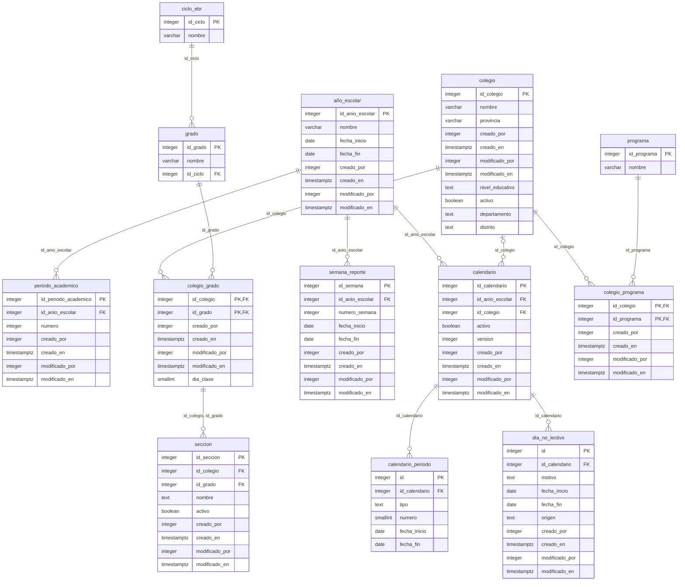
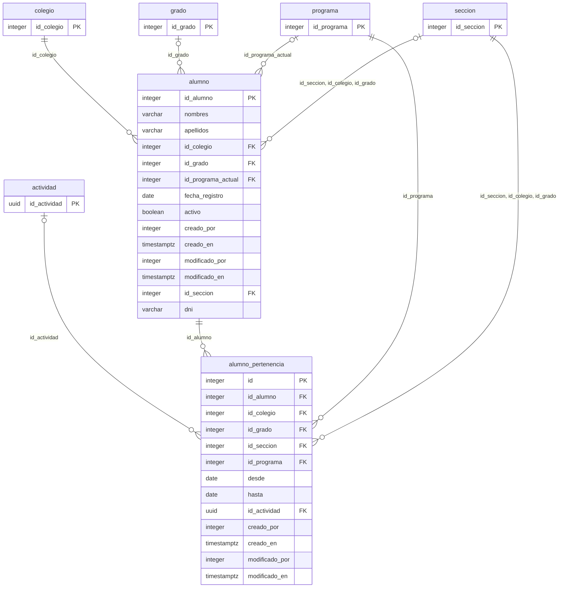
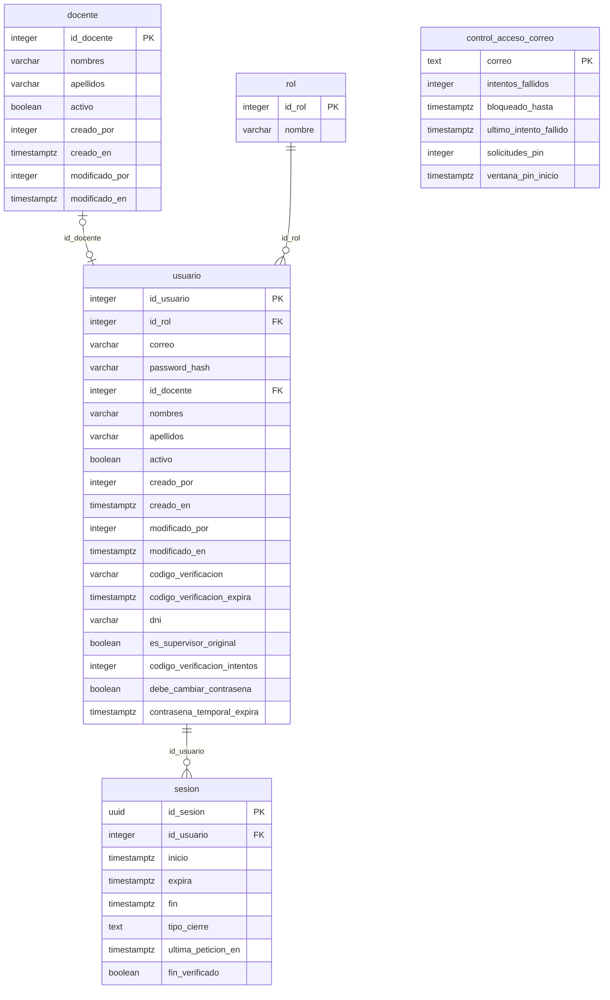
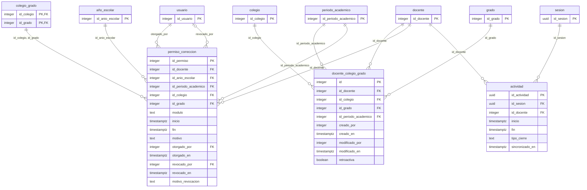
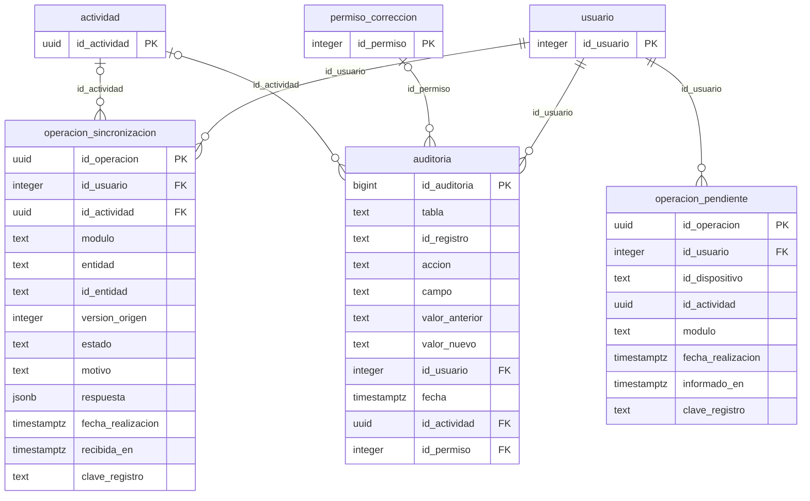
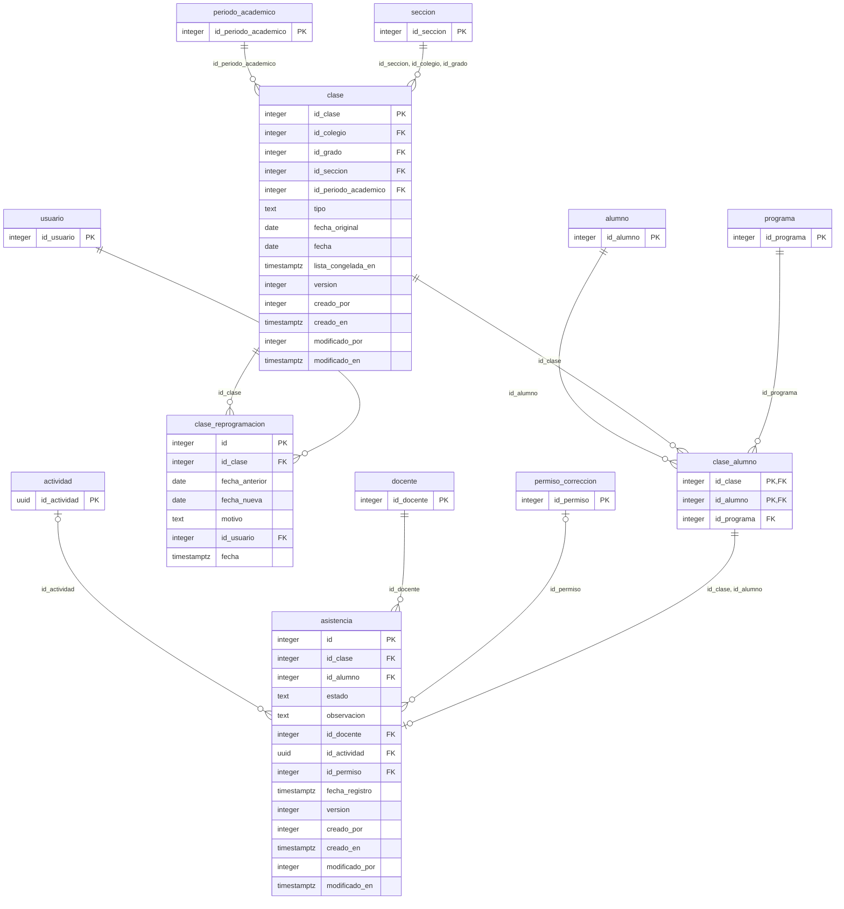
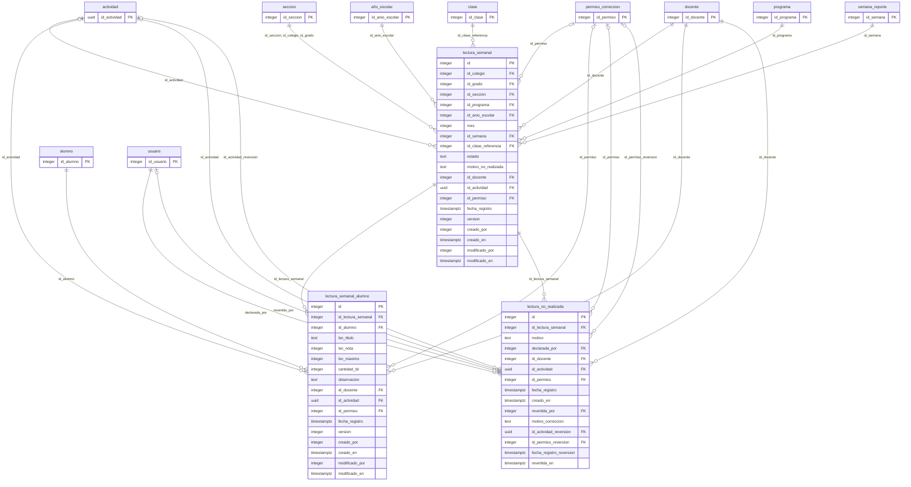
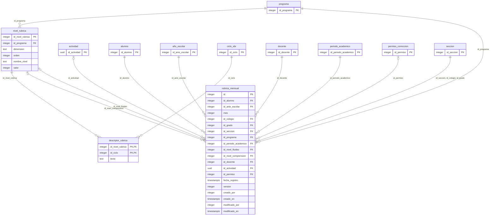
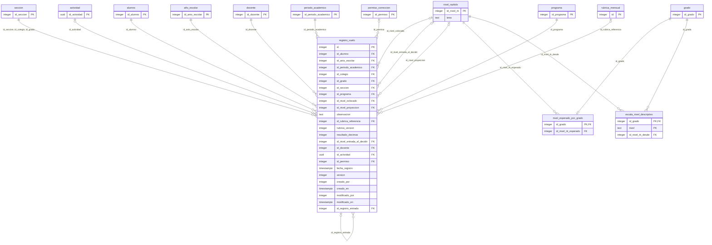

# Diseño de la base de datos · SICEDU (v5)

> Refleja: rama development en `372ec8f`, migración cabeza `c6e2a9d4f713`.
> Generado a partir del esquema real de PostgreSQL (alembic upgrade head) el 09/11/2026.
> Reemplaza al diseño v4 (21/10/2026).

## 1. Resumen

La base de datos guarda la organización de los colegios atendidos por Misión Huascarán (colegios, grados, secciones, subprogramas y calendario académico de cada año escolar), los alumnos y su pertenencia histórica a cada grupo, las cuentas de los tres roles con sus sesiones, y lo que registra el Docente en los cuatro módulos operativos: Asistencias, Seguimiento de Lectura, Rúbrica mensual y Registro de Vuelo. También guarda quién puede escribir y cuándo (asignaciones y permisos de corrección), las actividades de trabajo, el resultado de cada operación sincronizada y el historial de cambios.

Totales del esquema real: **40 tablas**, 374 columnas, 143 claves foráneas, 17 UNIQUE, 42 CHECK y 29 índices aparte de los de PK y UNIQUE.

| Módulo | Tablas | Cantidad |
|---|---|---|
| 4. Organización y calendario | [`año_escolar`](#año_escolar), [`periodo_academico`](#periodo_academico), [`calendario`](#calendario), [`calendario_periodo`](#calendario_periodo), [`dia_no_lectivo`](#dia_no_lectivo), [`semana_reporte`](#semana_reporte), [`ciclo_ebr`](#ciclo_ebr), [`grado`](#grado), [`programa`](#programa), [`colegio`](#colegio), [`colegio_grado`](#colegio_grado), [`colegio_programa`](#colegio_programa), [`seccion`](#seccion) | 13 |
| 5. Alumnos | [`alumno`](#alumno), [`alumno_pertenencia`](#alumno_pertenencia) | 2 |
| 6. Usuarios y seguridad | [`rol`](#rol), [`usuario`](#usuario), [`docente`](#docente), [`control_acceso_correo`](#control_acceso_correo), [`sesion`](#sesion) | 5 |
| 7. Habilitaciones y actividad | [`docente_colegio_grado`](#docente_colegio_grado), [`permiso_correccion`](#permiso_correccion), [`actividad`](#actividad) | 3 |
| 8. Sincronización y trazabilidad | [`operacion_sincronizacion`](#operacion_sincronizacion), [`operacion_pendiente`](#operacion_pendiente), [`auditoria`](#auditoria) | 3 |
| 9. Asistencias | [`clase`](#clase), [`clase_alumno`](#clase_alumno), [`clase_reprogramacion`](#clase_reprogramacion), [`asistencia`](#asistencia) | 4 |
| 10. Seguimiento de Lectura | [`lectura_semanal`](#lectura_semanal), [`lectura_semanal_alumno`](#lectura_semanal_alumno), [`lectura_no_realizada`](#lectura_no_realizada) | 3 |
| 11. Rúbrica mensual | [`nivel_rubrica`](#nivel_rubrica), [`descriptor_rubrica`](#descriptor_rubrica), [`rubrica_mensual`](#rubrica_mensual) | 3 |
| 12. Registro de Vuelo y escalas | [`registro_vuelo`](#registro_vuelo), [`nivel_razkids`](#nivel_razkids), [`nivel_esperado_por_grado`](#nivel_esperado_por_grado), [`escala_nivel_descriptivo`](#escala_nivel_descriptivo) | 4 |

## 2. Convenciones

- **Fechas y horas.** Los instantes son `TIMESTAMPTZ` en UTC (`ahora_utc()`, tipo `UTCDateTime` de `app/core/tiempo.py`). Los días son fechas `DATE` de Lima (`hoy_lima()`). El "día" y el "periodo" dependen del calendario de cada colegio: toda operación sobre un colegio pregunta con `periodo_de(db, id_colegio, fecha)`.
- **Auditoría de fila.** Casi todas las tablas llevan `creado_por`, `creado_en`, `modificado_por` y `modificado_en` (los `*_por` son FK a `usuario`). No los tienen los catálogos puros, las tablas técnicas y las que guardan su propio quién y cuándo (por ejemplo `otorgado_por` y `revocado_por` en `permiso_correccion`): `actividad`, `auditoria`, `calendario_periodo`, `ciclo_ebr`, `clase_alumno`, `clase_reprogramacion`, `control_acceso_correo`, `descriptor_rubrica`, `escala_nivel_descriptivo`, `grado`, `lectura_no_realizada`, `nivel_esperado_por_grado`, `nivel_razkids`, `nivel_rubrica`, `operacion_pendiente`, `operacion_sincronizacion`, `permiso_correccion`, `programa`, `rol`, `sesion`. `lectura_no_realizada` solo tiene `creado_en`.
- **Escritura del Docente.** Las tablas operativas llevan `id_docente`, `id_actividad`, `id_permiso`, `fecha_registro` y `version`, con el mismo significado en todas: `asistencia`, `lectura_semanal`, `lectura_semanal_alumno`, `registro_vuelo`, `rubrica_mensual`. `lectura_no_realizada` tiene las mismas columnas salvo `version`. `fecha_registro` es el momento real de la captura; `creado_en`, cuándo la guardó el servidor.
- **Historial.** El historial campo por campo va a `auditoria` (una fila por campo editado), con la actividad y el permiso usados.
- **Contexto histórico del grupo.** Las tablas operativas (`clase`, `lectura_semanal`, `rubrica_mensual` y `registro_vuelo`) guardan `id_colegio`, `id_grado` e `id_seccion` al registrar, con FK compuesta a `seccion` (`uq_seccion_grupo`), y las tres últimas también `id_programa`. Nunca se recalculan si el alumno cambia de grupo.
- **PostgreSQL y SQLite.** Las pruebas usan SQLite. Lo que solo existe en PostgreSQL (CHECK con `~`, el tipo `JSONB`) se valida también en el servicio. Los índices parciales se crean en los dos motores (`postgresql_where` y `sqlite_where`).
- **Nombres.** Minúscula con guion bajo. La tabla del año escolar se llama `año_escolar` (con ñ) y su clave `id_anio_escolar`; en los diagramas Mermaid aparece como `anio_escolar` con la etiqueta `año_escolar`.
- **Catálogos con id fijo.** `nivel_razkids` y `nivel_rubrica` se cargan con ids explícitos porque el id es parte del dato (en `nivel_razkids`, el id es el orden de la letra). `rol`, `ciclo_ebr`, `grado` y `programa` se buscan por nombre (`app/datos/catalogos.json`).
- **Borrado lógico.** Colegios, alumnos, usuarios, docentes y secciones no se eliminan: se inactivan con `activo`. Los permisos de corrección se revocan y las declaraciones "No realizada" se revierten, sin borrar filas.

## 3. Mapa de módulos (diagrama general)

Las 40 tablas y sus relaciones, sin columnas. No se dibujan las FK de auditoría (`creado_por`, `modificado_por` → `usuario`), que tienen casi todas las tablas.

```mermaid
erDiagram
    actividad
    alumno
    alumno_pertenencia
    asistencia
    auditoria
    anio_escolar["año_escolar"]
    calendario
    calendario_periodo
    ciclo_ebr
    clase
    clase_alumno
    clase_reprogramacion
    colegio
    colegio_grado
    colegio_programa
    control_acceso_correo
    descriptor_rubrica
    dia_no_lectivo
    docente
    docente_colegio_grado
    escala_nivel_descriptivo
    grado
    lectura_no_realizada
    lectura_semanal
    lectura_semanal_alumno
    nivel_esperado_por_grado
    nivel_razkids
    nivel_rubrica
    operacion_pendiente
    operacion_sincronizacion
    periodo_academico
    permiso_correccion
    programa
    registro_vuelo
    rol
    rubrica_mensual
    seccion
    semana_reporte
    sesion
    usuario
    docente ||--o{ actividad : "FK"
    sesion ||--o{ actividad : "FK"
    colegio ||--o{ alumno : "FK"
    grado |o--o{ alumno : "FK"
    programa |o--o{ alumno : "FK"
    seccion |o--o{ alumno : "FK"
    actividad |o--o{ alumno_pertenencia : "FK"
    alumno ||--o{ alumno_pertenencia : "FK"
    programa ||--o{ alumno_pertenencia : "FK"
    seccion ||--o{ alumno_pertenencia : "FK"
    actividad |o--o{ asistencia : "FK"
    docente ||--o{ asistencia : "FK"
    permiso_correccion |o--o{ asistencia : "FK"
    clase_alumno ||--o| asistencia : "FK"
    actividad |o--o{ auditoria : "FK"
    permiso_correccion |o--o{ auditoria : "FK"
    usuario ||--o{ auditoria : "FK"
    anio_escolar ||--o{ calendario : "FK"
    colegio |o--o{ calendario : "FK"
    calendario ||--o{ calendario_periodo : "FK"
    periodo_academico ||--o{ clase : "FK"
    seccion ||--o{ clase : "FK"
    alumno ||--o{ clase_alumno : "FK"
    clase ||--o{ clase_alumno : "FK"
    programa ||--o{ clase_alumno : "FK"
    clase ||--o{ clase_reprogramacion : "FK"
    usuario ||--o{ clase_reprogramacion : "FK"
    colegio ||--o{ colegio_grado : "FK"
    grado ||--o{ colegio_grado : "FK"
    colegio ||--o{ colegio_programa : "FK"
    programa ||--o{ colegio_programa : "FK"
    ciclo_ebr ||--o{ descriptor_rubrica : "FK"
    nivel_rubrica ||--o{ descriptor_rubrica : "FK"
    calendario ||--o{ dia_no_lectivo : "FK"
    colegio ||--o{ docente_colegio_grado : "FK"
    docente ||--o{ docente_colegio_grado : "FK"
    grado ||--o{ docente_colegio_grado : "FK"
    periodo_academico ||--o{ docente_colegio_grado : "FK"
    grado ||--o{ escala_nivel_descriptivo : "FK"
    nivel_razkids ||--o{ escala_nivel_descriptivo : "FK"
    ciclo_ebr ||--o{ grado : "FK"
    usuario ||--o{ lectura_no_realizada : "FK"
    actividad |o--o{ lectura_no_realizada : "FK"
    docente ||--o{ lectura_no_realizada : "FK"
    lectura_semanal ||--o{ lectura_no_realizada : "FK"
    permiso_correccion |o--o{ lectura_no_realizada : "FK"
    seccion ||--o{ lectura_semanal : "FK"
    actividad |o--o{ lectura_semanal : "FK"
    anio_escolar ||--o{ lectura_semanal : "FK"
    clase ||--o{ lectura_semanal : "FK"
    docente ||--o{ lectura_semanal : "FK"
    permiso_correccion |o--o{ lectura_semanal : "FK"
    programa ||--o{ lectura_semanal : "FK"
    semana_reporte ||--o{ lectura_semanal : "FK"
    actividad |o--o{ lectura_semanal_alumno : "FK"
    alumno ||--o{ lectura_semanal_alumno : "FK"
    docente ||--o{ lectura_semanal_alumno : "FK"
    lectura_semanal ||--o{ lectura_semanal_alumno : "FK"
    permiso_correccion |o--o{ lectura_semanal_alumno : "FK"
    grado ||--o| nivel_esperado_por_grado : "FK"
    nivel_razkids ||--o{ nivel_esperado_por_grado : "FK"
    programa ||--o{ nivel_rubrica : "FK"
    usuario ||--o{ operacion_pendiente : "FK"
    actividad |o--o{ operacion_sincronizacion : "FK"
    usuario ||--o{ operacion_sincronizacion : "FK"
    anio_escolar ||--o{ periodo_academico : "FK"
    colegio_grado ||--o{ permiso_correccion : "FK"
    anio_escolar ||--o{ permiso_correccion : "FK"
    docente ||--o{ permiso_correccion : "FK"
    periodo_academico ||--o{ permiso_correccion : "FK"
    usuario ||--o{ permiso_correccion : "FK"
    seccion ||--o{ registro_vuelo : "FK"
    actividad |o--o{ registro_vuelo : "FK"
    alumno ||--o{ registro_vuelo : "FK"
    anio_escolar ||--o{ registro_vuelo : "FK"
    docente ||--o{ registro_vuelo : "FK"
    nivel_razkids |o--o{ registro_vuelo : "FK"
    periodo_academico ||--o{ registro_vuelo : "FK"
    permiso_correccion |o--o{ registro_vuelo : "FK"
    programa ||--o{ registro_vuelo : "FK"
    registro_vuelo |o--o{ registro_vuelo : "FK"
    rubrica_mensual |o--o{ registro_vuelo : "FK"
    seccion ||--o{ rubrica_mensual : "FK"
    actividad |o--o{ rubrica_mensual : "FK"
    alumno ||--o{ rubrica_mensual : "FK"
    anio_escolar ||--o{ rubrica_mensual : "FK"
    docente ||--o{ rubrica_mensual : "FK"
    nivel_rubrica |o--o{ rubrica_mensual : "FK"
    periodo_academico ||--o{ rubrica_mensual : "FK"
    permiso_correccion |o--o{ rubrica_mensual : "FK"
    programa ||--o{ rubrica_mensual : "FK"
    colegio_grado ||--o{ seccion : "FK"
    anio_escolar ||--o{ semana_reporte : "FK"
    usuario ||--o{ sesion : "FK"
    docente |o--o| usuario : "FK"
    rol ||--o{ usuario : "FK"
```

## 4. Organización y calendario

Estructura de los colegios y del tiempo escolar. Atiende CU013 (colegios, grados, secciones, subprogramas y programación de clases) y CU027 (calendario académico). El año escolar tiene un calendario general y cada colegio puede tener uno particular activo; los periodos (PA y PR) y los días no lectivos salen del calendario que le aplica a cada colegio. Las semanas del año se generan desde las fechas del año escolar. Los catálogos `ciclo_ebr`, `grado` y `programa` se cargan con `python -m app.cli cargar-catalogos`.

Diagrama del módulo (las tablas de otros módulos aparecen solo con su PK; no se dibujan las FK de auditoría):

### `año_escolar`

**Descripción:** Un año escolar ("2026"). Se crea junto con su calendario general, desde la API (CU027) o con `cargar-calendario`, y sus fechas se sincronizan con ese calendario cada vez que cambia (`app/services/anio_escolar.py`).

| Campo | Tamaño | Tipo de Dato | Descripción | NULL |
|---|---|---|---|---|
| `id_anio_escolar` | 4 bytes | INTEGER | Identificador del año escolar. Clave primaria. | NO |
| `nombre` | Variable | VARCHAR | Año en texto, por ejemplo "2026". No se repite. | NO |
| `fecha_inicio` | 4 bytes | DATE | Primer día del año escolar: inicio del PA1 de su calendario general. | NO |
| `fecha_fin` | 4 bytes | DATE | Último día del año escolar: fin del PR4 de su calendario general. | NO |
| `creado_por` | 4 bytes | INTEGER | Usuario que creó la fila. Clave foránea a `usuario`. | NO |
| `creado_en` | 8 bytes | TIMESTAMPTZ | Instante en que el servidor guardó la fila (UTC). | NO |
| `modificado_por` | 4 bytes | INTEGER | Último usuario que modificó la fila. NULL = nunca modificada. Clave foránea a `usuario`. | SÍ |
| `modificado_en` | 8 bytes | TIMESTAMPTZ | Instante de la última modificación (UTC). NULL = nunca modificada. | SÍ |

**Restricciones:**

- PK: (`id_anio_escolar`), `año_escolar_pkey`.
- FK:
  - `creado_por`, `modificado_por` → `usuario` (`id_usuario`): `año_escolar_creado_por_fkey`, `año_escolar_modificado_por_fkey` (auditoría).
- UNIQUE:
  - `uq_anio_escolar_nombre`: (`nombre`). Un solo año escolar por nombre.
- CHECK: no tiene.

**Índices:**

No tiene índices aparte de los de su PK y sus UNIQUE.

**Reglas del servicio:**

- Las fechas son siempre las del calendario general (inicio del PA1 a fin del PR4); los particulares no las cambian.
- El calendario no puede durar más de doce meses, el PA1 no se superpone con el PR4 del año anterior y el PR4 no se superpone con el PA1 del siguiente.
- Un cambio del general que dejaría fuera del año semanas con tablas de lectura se rechaza (409).

### `periodo_academico`

**Descripción:** Identidad "PA n del año X", sin fechas. Se crean los cuatro PA del año al guardar su calendario general (`asegurar_periodos_academicos`). Las fechas de cada PA salen del calendario que le aplica a cada colegio (`calendario_periodo`).

| Campo | Tamaño | Tipo de Dato | Descripción | NULL |
|---|---|---|---|---|
| `id_periodo_academico` | 4 bytes | INTEGER | Identificador del PA. Clave primaria. | NO |
| `id_anio_escolar` | 4 bytes | INTEGER | Año escolar del PA. Clave foránea a `año_escolar`. | NO |
| `numero` | 4 bytes | INTEGER | Número del PA dentro del año: 1 a 4. | NO |
| `creado_por` | 4 bytes | INTEGER | Usuario que creó la fila. Clave foránea a `usuario`. | NO |
| `creado_en` | 8 bytes | TIMESTAMPTZ | Instante en que el servidor guardó la fila (UTC). | NO |
| `modificado_por` | 4 bytes | INTEGER | Último usuario que modificó la fila. NULL = nunca modificada. Clave foránea a `usuario`. | SÍ |
| `modificado_en` | 8 bytes | TIMESTAMPTZ | Instante de la última modificación (UTC). NULL = nunca modificada. | SÍ |

**Restricciones:**

- PK: (`id_periodo_academico`), `periodo_academico_pkey`.
- FK:
  - `id_anio_escolar` → `año_escolar` (`id_anio_escolar`): `periodo_academico_id_anio_escolar_fkey`.
  - `creado_por`, `modificado_por` → `usuario` (`id_usuario`): `periodo_academico_creado_por_fkey`, `periodo_academico_modificado_por_fkey` (auditoría).
- UNIQUE:
  - `uq_periodo_academico_anio_numero`: (`id_anio_escolar`, `numero`). Un solo PA por número en cada año escolar.
- CHECK: no tiene.

**Índices:**

No tiene índices aparte de los de su PK y sus UNIQUE.

**Reglas del servicio:**

- El número va de 1 a 4: lo garantiza el servicio, que solo crea los PA1 a PA4 (no hay CHECK).
- Los recesos (PR) no tienen fila aquí: solo existen en `calendario_periodo`.

### `calendario`

**Descripción:** Calendario académico de un año escolar (CU027): el general (`id_colegio` NULL) o el particular de un colegio. Lo escribe el Supervisor. "Usar calendario general" desactiva el particular sin borrarlo, para conservar su historial.

| Campo | Tamaño | Tipo de Dato | Descripción | NULL |
|---|---|---|---|---|
| `id_calendario` | 4 bytes | INTEGER | Identificador del calendario. Clave primaria. | NO |
| `id_anio_escolar` | 4 bytes | INTEGER | Año escolar del calendario. Clave foránea a `año_escolar`. | NO |
| `id_colegio` | 4 bytes | INTEGER | Colegio del calendario particular. NULL = calendario general del año. Clave foránea a `colegio`. | SÍ |
| `activo` | 1 byte | BOOLEAN | Si el calendario está en uso. false = particular reemplazado por el general. El general siempre está activo. | NO |
| `version` | 4 bytes | INTEGER | Versión de la fila: empieza en 1 y sube con cada cambio. Su uso en el control de concurrencia se indica en las reglas del servicio. | NO |
| `creado_por` | 4 bytes | INTEGER | Usuario que creó la fila. Clave foránea a `usuario`. | NO |
| `creado_en` | 8 bytes | TIMESTAMPTZ | Instante en que el servidor guardó la fila (UTC). | NO |
| `modificado_por` | 4 bytes | INTEGER | Último usuario que modificó la fila. NULL = nunca modificada. Clave foránea a `usuario`. | SÍ |
| `modificado_en` | 8 bytes | TIMESTAMPTZ | Instante de la última modificación (UTC). NULL = nunca modificada. | SÍ |

**Restricciones:**

- PK: (`id_calendario`), `calendario_pkey`.
- FK:
  - `id_anio_escolar` → `año_escolar` (`id_anio_escolar`): `calendario_id_anio_escolar_fkey`.
  - `id_colegio` → `colegio` (`id_colegio`): `calendario_id_colegio_fkey`.
  - `creado_por`, `modificado_por` → `usuario` (`id_usuario`): `calendario_creado_por_fkey`, `calendario_modificado_por_fkey` (auditoría).
- UNIQUE: no tiene.
- CHECK:
  - `ck_calendario_general_activo`: `CHECK (((id_colegio IS NOT NULL) OR activo))`. El general no se desactiva: solo un particular puede quedar inactivo.

**Índices:**

- `uq_calendario_general_por_anio`: Único sobre (`id_anio_escolar`), parcial: `WHERE (id_colegio IS NULL)`. Un solo calendario general por año.
- `uq_calendario_particular_activo`: Único sobre (`id_anio_escolar`, `id_colegio`), parcial: `WHERE ((id_colegio IS NOT NULL) AND activo)`. Como máximo un calendario particular activo por colegio y año.

**Reglas del servicio:**

- El calendario de un colegio en un año es su particular activo si existe; si no, el general (`calendario_aplicable`).
- `version` es el control de concurrencia entre Supervisores: una edición con otra versión se rechaza (409).
- Un cambio que deja registros (clases, tablas de lectura, rúbricas, decisiones del Registro de Vuelo) fuera de su PA se rechaza (409).
- Los cambios de periodos y días no lectivos quedan en `auditoria` como los campos `periodos` y `dias_no_lectivos`, con sus valores en JSON.

### `calendario_periodo`

**Descripción:** Los ocho periodos de un calendario: PA1, PR1, ..., PA4, PR4, con fechas inclusivas. PR n es el receso posterior al PA n. Las escribe el servicio al guardar el calendario; sus cambios se auditan en el calendario.

| Campo | Tamaño | Tipo de Dato | Descripción | NULL |
|---|---|---|---|---|
| `id` | 4 bytes | INTEGER | Identificador del periodo del calendario. Clave primaria. | NO |
| `id_calendario` | 4 bytes | INTEGER | Calendario al que pertenece. Clave foránea a `calendario`. | NO |
| `tipo` | Variable | TEXT | 'PA' = periodo académico; 'PR' = receso posterior al PA del mismo número. | NO |
| `numero` | 2 bytes | SMALLINT | Número del periodo: 1 a 4. | NO |
| `fecha_inicio` | 4 bytes | DATE | Primer día del periodo (inclusivo). | NO |
| `fecha_fin` | 4 bytes | DATE | Último día del periodo (inclusivo). | NO |

**Restricciones:**

- PK: (`id`), `calendario_periodo_pkey`.
- FK:
  - `id_calendario` → `calendario` (`id_calendario`): `calendario_periodo_id_calendario_fkey`.
- UNIQUE:
  - `uq_calendario_periodo_tipo_numero`: (`id_calendario`, `tipo`, `numero`). Un solo PA n y un solo PR n por calendario.
- CHECK:
  - `ck_calendario_periodo_fechas`: `CHECK ((fecha_fin >= fecha_inicio))`. El fin no es anterior al inicio.
  - `ck_calendario_periodo_numero`: `CHECK (((numero >= 1) AND (numero <= 4)))`. El número va de 1 a 4.
  - `ck_calendario_periodo_tipo`: `CHECK ((tipo = ANY (ARRAY['PA'::text, 'PR'::text])))`. Solo PA o PR.

**Índices:**

No tiene índices aparte de los de su PK y sus UNIQUE.

**Reglas del servicio:**

- Cada calendario tiene sus ocho filas, en orden cronológico y sin superponerse (`errores_de_periodos`).
- Fuera de un PA ningún día es lectivo.

### `dia_no_lectivo`

**Descripción:** Feriado o suspensión de un calendario (CU027), como rango inclusivo de fechas. Lo carga el comando `cargar-feriados` o lo registra un Supervisor. Reemplaza a `dia_no_laborable`, que era global.

| Campo | Tamaño | Tipo de Dato | Descripción | NULL |
|---|---|---|---|---|
| `id` | 4 bytes | INTEGER | Identificador del día no lectivo. Clave primaria. | NO |
| `id_calendario` | 4 bytes | INTEGER | Calendario al que pertenece. Clave foránea a `calendario`. | NO |
| `motivo` | Variable | TEXT | Motivo del día no lectivo (no vacío). | NO |
| `fecha_inicio` | 4 bytes | DATE | Primer día no lectivo (inclusivo). | NO |
| `fecha_fin` | 4 bytes | DATE | Último día no lectivo (inclusivo). | NO |
| `origen` | Variable | TEXT | 'automatico' = cargado por `cargar-feriados`; 'manual' = registrado por un Supervisor. | NO |
| `creado_por` | 4 bytes | INTEGER | Usuario que creó la fila. Clave foránea a `usuario`. | NO |
| `creado_en` | 8 bytes | TIMESTAMPTZ | Instante en que el servidor guardó la fila (UTC). | NO |
| `modificado_por` | 4 bytes | INTEGER | Último usuario que modificó la fila. NULL = nunca modificada. Clave foránea a `usuario`. | SÍ |
| `modificado_en` | 8 bytes | TIMESTAMPTZ | Instante de la última modificación (UTC). NULL = nunca modificada. | SÍ |

**Restricciones:**

- PK: (`id`), `dia_no_lectivo_pkey`.
- FK:
  - `id_calendario` → `calendario` (`id_calendario`): `dia_no_lectivo_id_calendario_fkey`.
  - `creado_por`, `modificado_por` → `usuario` (`id_usuario`): `dia_no_lectivo_creado_por_fkey`, `dia_no_lectivo_modificado_por_fkey` (auditoría).
- UNIQUE: no tiene.
- CHECK:
  - `ck_dia_no_lectivo_fechas`: `CHECK ((fecha_fin >= fecha_inicio))`. El fin no es anterior al inicio.
  - `ck_dia_no_lectivo_motivo`: `CHECK ((length(TRIM(BOTH FROM motivo)) > 0))`. El motivo no puede ser vacío ni solo espacios.
  - `ck_dia_no_lectivo_origen`: `CHECK ((origen = ANY (ARRAY['automatico'::text, 'manual'::text])))`. Solo los dos orígenes posibles.

**Índices:**

- `ix_dia_no_lectivo_calendario_inicio`: Índice sobre (`id_calendario`, `fecha_inicio`). Días no lectivos de un calendario por fecha, para resolver si un día es lectivo.

**Reglas del servicio:**

- Todas sus fechas caen dentro de los periodos del calendario, PA o PR (incluido el PR4 aunque pase al año calendario siguiente).
- No se superpone con otro día no lectivo del mismo calendario.
- No divide periodos ni cambia fechas: uno dentro de un PA no lo vuelve receso, y uno dentro de un PR no amplía el plazo de regularización.

### `semana_reporte`

**Descripción:** Semana de lunes a viernes del año escolar, con número correlativo. Se generan desde las fechas del año escolar (`sincronizar_anio`) al crear o editar el calendario general y al arrancar con `inicializar`. No dependen de los PA: el PA de una semana depende del colegio.

| Campo | Tamaño | Tipo de Dato | Descripción | NULL |
|---|---|---|---|---|
| `id_semana` | 4 bytes | INTEGER | Identificador de la semana. Clave primaria. | NO |
| `id_anio_escolar` | 4 bytes | INTEGER | Año escolar de la semana. Clave foránea a `año_escolar`. | NO |
| `numero_semana` | 4 bytes | INTEGER | Número correlativo de la semana dentro del año (1 a N). | NO |
| `fecha_inicio` | 4 bytes | DATE | Lunes de la semana. | NO |
| `fecha_fin` | 4 bytes | DATE | Viernes de la semana. | NO |
| `creado_por` | 4 bytes | INTEGER | Usuario que creó la fila. Clave foránea a `usuario`. | NO |
| `creado_en` | 8 bytes | TIMESTAMPTZ | Instante en que el servidor guardó la fila (UTC). | NO |
| `modificado_por` | 4 bytes | INTEGER | Último usuario que modificó la fila. NULL = nunca modificada. Clave foránea a `usuario`. | SÍ |
| `modificado_en` | 8 bytes | TIMESTAMPTZ | Instante de la última modificación (UTC). NULL = nunca modificada. | SÍ |

**Restricciones:**

- PK: (`id_semana`), `semana_reporte_pkey`.
- FK:
  - `id_anio_escolar` → `año_escolar` (`id_anio_escolar`): `semana_reporte_id_anio_escolar_fkey`.
  - `creado_por`, `modificado_por` → `usuario` (`id_usuario`): `semana_reporte_creado_por_fkey`, `semana_reporte_modificado_por_fkey` (auditoría).
- UNIQUE: no tiene.
- CHECK: no tiene.

**Índices:**

No tiene índices aparte de los de su PK y sus UNIQUE.

**Reglas del servicio:**

- Toda semana con al menos un día hábil dentro del año escolar tiene fila; las que quedan fuera al cambiar el año se eliminan si no tienen tablas de lectura.
- La unicidad de la semana por año y lunes la mantiene el servicio (no hay UNIQUE).
- Una semana sin clase del grupo no tiene tabla de lectura ni obligación.

### `ciclo_ebr`

**Descripción:** Catálogo de ciclos de la Educación Básica Regular: III, IV y V.

| Campo | Tamaño | Tipo de Dato | Descripción | NULL |
|---|---|---|---|---|
| `id_ciclo` | 4 bytes | INTEGER | Identificador del ciclo. Clave primaria. | NO |
| `nombre` | Variable | VARCHAR | Nombre del ciclo: III, IV o V. | NO |

**Restricciones:**

- PK: (`id_ciclo`), `ciclo_ebr_pkey`.
- FK: no tiene.
- UNIQUE: no tiene.
- CHECK: no tiene.

**Índices:**

No tiene índices aparte de los de su PK y sus UNIQUE.

**Reglas del servicio:**

Ninguna aparte de las restricciones.

### `grado`

**Descripción:** Catálogo de grados de primaria: 1.º a 6.º, cada uno con su ciclo EBR.

| Campo | Tamaño | Tipo de Dato | Descripción | NULL |
|---|---|---|---|---|
| `id_grado` | 4 bytes | INTEGER | Identificador del grado. Clave primaria. | NO |
| `nombre` | Variable | VARCHAR | Nombre del grado: "1.º" a "6.º". | NO |
| `id_ciclo` | 4 bytes | INTEGER | Ciclo EBR del grado (1.º y 2.º: III; 3.º y 4.º: IV; 5.º y 6.º: V). Clave foránea a `ciclo_ebr`. | NO |

**Restricciones:**

- PK: (`id_grado`), `grado_pkey`.
- FK:
  - `id_ciclo` → `ciclo_ebr` (`id_ciclo`): `grado_id_ciclo_fkey`.
- UNIQUE: no tiene.
- CHECK: no tiene.

**Índices:**

No tiene índices aparte de los de su PK y sus UNIQUE.

**Reglas del servicio:**

Ninguna aparte de las restricciones.

### `programa`

**Descripción:** Catálogo de subprogramas: Alfabetización y Comprensión Lectora.

| Campo | Tamaño | Tipo de Dato | Descripción | NULL |
|---|---|---|---|---|
| `id_programa` | 4 bytes | INTEGER | Identificador del subprograma. Clave primaria. | NO |
| `nombre` | Variable | VARCHAR | Nombre del subprograma. | NO |

**Restricciones:**

- PK: (`id_programa`), `programa_pkey`.
- FK: no tiene.
- UNIQUE: no tiene.
- CHECK: no tiene.

**Índices:**

No tiene índices aparte de los de su PK y sus UNIQUE.

**Reglas del servicio:**

Ninguna aparte de las restricciones.

### `colegio`

**Descripción:** Un colegio atendido (CU013). Lo crea y edita el Supervisor; no se borra, se inactiva.

| Campo | Tamaño | Tipo de Dato | Descripción | NULL |
|---|---|---|---|---|
| `id_colegio` | 4 bytes | INTEGER | Identificador del colegio. Clave primaria. | NO |
| `nombre` | Variable | VARCHAR | Nombre del colegio. | NO |
| `provincia` | Variable | VARCHAR | Provincia (obligatoria; 'Por definir' en los colegios que no la tenían). | NO |
| `creado_por` | 4 bytes | INTEGER | Usuario que creó la fila. Clave foránea a `usuario`. | NO |
| `creado_en` | 8 bytes | TIMESTAMPTZ | Instante en que el servidor guardó la fila (UTC). | NO |
| `modificado_por` | 4 bytes | INTEGER | Último usuario que modificó la fila. NULL = nunca modificada. Clave foránea a `usuario`. | SÍ |
| `modificado_en` | 8 bytes | TIMESTAMPTZ | Instante de la última modificación (UTC). NULL = nunca modificada. | SÍ |
| `nivel_educativo` | Variable | TEXT | Nivel educativo. Hoy el único valor es 'Primaria' (valor por defecto). | NO |
| `activo` | 1 byte | BOOLEAN | false = colegio inactivo: sus alumnos no salen en los listados ni en el alcance del Docente. | NO |
| `departamento` | Variable | TEXT | Departamento. | NO |
| `distrito` | Variable | TEXT | Distrito. NULL = no informado. | SÍ |

**Restricciones:**

- PK: (`id_colegio`), `colegio_pkey`.
- FK:
  - `creado_por`, `modificado_por` → `usuario` (`id_usuario`): `colegio_creado_por_fkey`, `colegio_modificado_por_fkey` (auditoría).
- UNIQUE: no tiene.
- CHECK: no tiene.

**Índices:**

No tiene índices aparte de los de su PK y sus UNIQUE.

**Reglas del servicio:**

- Un colegio inactivo no afecta a sus alumnos, pero moverlos a él o activarlos exige un colegio activo.

### `colegio_grado`

**Descripción:** Grados que ofrece cada colegio (CU013), con su día de clase semanal.

| Campo | Tamaño | Tipo de Dato | Descripción | NULL |
|---|---|---|---|---|
| `id_colegio` | 4 bytes | INTEGER | Colegio. Parte de la clave primaria. Clave foránea a `colegio`. | NO |
| `id_grado` | 4 bytes | INTEGER | Grado que ofrece. Parte de la clave primaria. Clave foránea a `grado`. | NO |
| `creado_por` | 4 bytes | INTEGER | Usuario que creó la fila. Clave foránea a `usuario`. | NO |
| `creado_en` | 8 bytes | TIMESTAMPTZ | Instante en que el servidor guardó la fila (UTC). | NO |
| `modificado_por` | 4 bytes | INTEGER | Último usuario que modificó la fila. NULL = nunca modificada. Clave foránea a `usuario`. | SÍ |
| `modificado_en` | 8 bytes | TIMESTAMPTZ | Instante de la última modificación (UTC). NULL = nunca modificada. | SÍ |
| `dia_clase` | 2 bytes | SMALLINT | Día de clase semanal del grado: 1 = lunes ... 5 = viernes. NULL = sin día de clase (colegios cargados antes de pedirse): no genera clases habituales ni vencidos. | SÍ |

**Restricciones:**

- PK: (`id_colegio`, `id_grado`), `colegio_grado_pkey`.
- FK:
  - `id_colegio` → `colegio` (`id_colegio`): `colegio_grado_id_colegio_fkey`.
  - `id_grado` → `grado` (`id_grado`): `colegio_grado_id_grado_fkey`.
  - `creado_por`, `modificado_por` → `usuario` (`id_usuario`): `colegio_grado_creado_por_fkey`, `colegio_grado_modificado_por_fkey` (auditoría).
- UNIQUE: no tiene.
- CHECK:
  - `ck_colegio_grado_dia_clase`: `CHECK (((dia_clase >= 1) AND (dia_clase <= 5)))`. El día de clase va de lunes (1) a viernes (5).

**Índices:**

No tiene índices aparte de los de su PK y sus UNIQUE.

**Reglas del servicio:**

- Cada grado ofrecido tiene al menos una sección ("Única" al crearlo).

### `colegio_programa`

**Descripción:** Subprogramas que ofrece cada colegio (CU013). Es por colegio, no por grado.

| Campo | Tamaño | Tipo de Dato | Descripción | NULL |
|---|---|---|---|---|
| `id_colegio` | 4 bytes | INTEGER | Colegio. Parte de la clave primaria. Clave foránea a `colegio`. | NO |
| `id_programa` | 4 bytes | INTEGER | Subprograma que ofrece. Parte de la clave primaria. Clave foránea a `programa`. | NO |
| `creado_por` | 4 bytes | INTEGER | Usuario que creó la fila. Clave foránea a `usuario`. | NO |
| `creado_en` | 8 bytes | TIMESTAMPTZ | Instante en que el servidor guardó la fila (UTC). | NO |
| `modificado_por` | 4 bytes | INTEGER | Último usuario que modificó la fila. NULL = nunca modificada. Clave foránea a `usuario`. | SÍ |
| `modificado_en` | 8 bytes | TIMESTAMPTZ | Instante de la última modificación (UTC). NULL = nunca modificada. | SÍ |

**Restricciones:**

- PK: (`id_colegio`, `id_programa`), `colegio_programa_pkey`.
- FK:
  - `id_colegio` → `colegio` (`id_colegio`): `colegio_programa_id_colegio_fkey`.
  - `id_programa` → `programa` (`id_programa`): `colegio_programa_id_programa_fkey`.
  - `creado_por`, `modificado_por` → `usuario` (`id_usuario`): `colegio_programa_creado_por_fkey`, `colegio_programa_modificado_por_fkey` (auditoría).
- UNIQUE: no tiene.
- CHECK: no tiene.

**Índices:**

No tiene índices aparte de los de su PK y sus UNIQUE.

**Reglas del servicio:**

Ninguna aparte de las restricciones.

### `seccion`

**Descripción:** Sección de un grado de un colegio (CU013). Cada grado nace con la sección "Única". Solo se agregan: no hay renombrar ni eliminar (decisión de Carlos).

| Campo | Tamaño | Tipo de Dato | Descripción | NULL |
|---|---|---|---|---|
| `id_seccion` | 4 bytes | INTEGER | Identificador de la sección. Clave primaria. | NO |
| `id_colegio` | 4 bytes | INTEGER | Colegio de la sección. Con `id_grado`, clave foránea a `colegio_grado`. | NO |
| `id_grado` | 4 bytes | INTEGER | Grado de la sección. Con `id_colegio`, clave foránea a `colegio_grado`. | NO |
| `nombre` | Variable | TEXT | Nombre de la sección (no vacío), por ejemplo "Única" o "A". | NO |
| `activo` | 1 byte | BOOLEAN | Reservado para inactivar una sección más adelante. Hoy ninguna operación lo cambia (las secciones solo se agregan) y todas se crean activas; las consultas de secciones y de asignaciones filtran por activo = true. | NO |
| `creado_por` | 4 bytes | INTEGER | Usuario que creó la fila. Clave foránea a `usuario`. | NO |
| `creado_en` | 8 bytes | TIMESTAMPTZ | Instante en que el servidor guardó la fila (UTC). | NO |
| `modificado_por` | 4 bytes | INTEGER | Último usuario que modificó la fila. NULL = nunca modificada. Clave foránea a `usuario`. | SÍ |
| `modificado_en` | 8 bytes | TIMESTAMPTZ | Instante de la última modificación (UTC). NULL = nunca modificada. | SÍ |

**Restricciones:**

- PK: (`id_seccion`), `seccion_pkey`.
- FK:
  - `id_colegio`, `id_grado` → `colegio_grado` (`id_colegio`, `id_grado`): `fk_seccion_colegio_grado`.
  - `creado_por`, `modificado_por` → `usuario` (`id_usuario`): `seccion_creado_por_fkey`, `seccion_modificado_por_fkey` (auditoría).
- UNIQUE:
  - `uq_seccion_colegio_grado_nombre`: (`id_colegio`, `id_grado`, `nombre`). Un nombre de sección no se repite en el mismo grado de un colegio.
  - `uq_seccion_grupo`: (`id_seccion`, `id_colegio`, `id_grado`). Destino de las FK compuestas (sección + colegio + grado) de `alumno`, `alumno_pertenencia`, `clase`, `lectura_semanal`, `rubrica_mensual` y `registro_vuelo`: la base de datos impide usar una sección de otro colegio o grado.
- CHECK:
  - `ck_seccion_nombre`: `CHECK ((length(TRIM(BOTH FROM nombre)) > 0))`. El nombre no puede ser vacío ni solo espacios.

**Índices:**

No tiene índices aparte de los de su PK y sus UNIQUE.

**Reglas del servicio:**

- Cada grado tiene siempre al menos una sección activa.
- Dos nombres que difieren solo en mayúsculas, tildes o espacios son la misma sección (la UNIQUE compara el texto exacto).
- Si el grado tiene una sola sección activa, se asigna sola al alumno; si tiene varias, hay que elegirla.

## 5. Alumnos

Alumnos y su pertenencia histórica a un grupo (CU014, CU015). `alumno` guarda la foto del grupo vigente; `alumno_pertenencia` responde "quién estaba en el grupo en esta fecha" y arma las listas de Asistencias, Lectura, Rúbrica y Registro de Vuelo.

Diagrama del módulo (las tablas de otros módulos aparecen solo con su PK; no se dibujan las FK de auditoría):

### `alumno`

**Descripción:** Un alumno (CU014). Lo crea el Supervisor o un Docente de su alcance (con actividad). Sus columnas de grupo son la foto del grupo vigente; el historial está en `alumno_pertenencia`. Ningún alumno se elimina: se inactiva.

| Campo | Tamaño | Tipo de Dato | Descripción | NULL |
|---|---|---|---|---|
| `id_alumno` | 4 bytes | INTEGER | Identificador del alumno. Clave primaria. | NO |
| `nombres` | Variable | VARCHAR | Nombres del alumno. | NO |
| `apellidos` | Variable | VARCHAR | Apellidos del alumno. | NO |
| `id_colegio` | 4 bytes | INTEGER | Colegio actual del alumno (uno solo). Clave foránea a `colegio`; con `id_seccion` e `id_grado`, clave foránea a `seccion`. | NO |
| `id_grado` | 4 bytes | INTEGER | Grado actual del alumno (uno solo). NULL = alumno con pertenencia pendiente (importado desde una nómina, CU014), sin intervalos en `alumno_pertenencia`. Clave foránea a `grado`; con `id_seccion` e `id_colegio`, clave foránea a `seccion`. | SÍ |
| `id_programa_actual` | 4 bytes | INTEGER | Subprograma actual (foto del grupo vigente). NULL = alumno con pertenencia pendiente (importado desde una nómina, CU014), sin intervalos en `alumno_pertenencia`. Clave foránea a `programa`. | SÍ |
| `fecha_registro` | 4 bytes | DATE | Día (fecha de Lima) en que se registró el alumno en el sistema. | NO |
| `activo` | 1 byte | BOOLEAN | false = alumno inactivo (borrado lógico). | NO |
| `creado_por` | 4 bytes | INTEGER | Usuario que creó la fila. Clave foránea a `usuario`. | NO |
| `creado_en` | 8 bytes | TIMESTAMPTZ | Instante en que el servidor guardó la fila (UTC). | NO |
| `modificado_por` | 4 bytes | INTEGER | Último usuario que modificó la fila. NULL = nunca modificada. Clave foránea a `usuario`. | SÍ |
| `modificado_en` | 8 bytes | TIMESTAMPTZ | Instante de la última modificación (UTC). NULL = nunca modificada. | SÍ |
| `id_seccion` | 4 bytes | INTEGER | Sección actual (foto del grupo vigente, igual que `id_programa_actual`). NULL = alumno con pertenencia pendiente (importado desde una nómina, CU014), sin intervalos en `alumno_pertenencia`. Con `id_colegio` e `id_grado`, clave foránea a `seccion`. | SÍ |
| `dni` | 8 caracteres | VARCHAR(8) | DNI del alumno (opcional). Texto de 8 dígitos, único entre alumnos e independiente del DNI de `usuario`. | SÍ |

**Restricciones:**

- PK: (`id_alumno`), `alumno_pkey`.
- FK:
  - `id_colegio` → `colegio` (`id_colegio`): `alumno_id_colegio_fkey`.
  - `id_grado` → `grado` (`id_grado`): `alumno_id_grado_fkey`.
  - `id_programa_actual` → `programa` (`id_programa`): `alumno_id_programa_actual_fkey`.
  - `id_seccion`, `id_colegio`, `id_grado` → `seccion` (`id_seccion`, `id_colegio`, `id_grado`): `fk_alumno_seccion`.
  - `creado_por`, `modificado_por` → `usuario` (`id_usuario`): `alumno_creado_por_fkey`, `alumno_modificado_por_fkey` (auditoría).
- UNIQUE: no tiene.
- CHECK:
  - `ck_alumno_dni_formato`: `CHECK (((dni)::text ~ '^[0-9]{8}$'::text))`. El DNI tiene exactamente 8 dígitos.
  - `ck_alumno_grupo_coherente`: `CHECK ((((id_seccion IS NULL) = (id_programa_actual IS NULL)) AND ((id_seccion IS NULL) OR (id_grado IS NOT NULL))))`. La sección y el subprograma van juntos y, si hay sección, hay grado.

**Índices:**

- `ix_alumno_colegio_grado`: Índice sobre (`id_colegio`, `id_grado`). Alumnos de un aula (asistencia, vencidos e incompletos de CU011).
- `uq_alumno_dni`: Único sobre (`dni`), parcial: `WHERE (dni IS NOT NULL)`. Un DNI no se repite entre alumnos; varios alumnos pueden no tenerlo.

**Reglas del servicio:**

- En 1.º grado todos los alumnos son de Alfabetización.
- Crear, cambiar de grupo, inactivar y activar llevan una fecha efectiva (hoy o antes) y abren o cierran intervalos de `alumno_pertenencia` en la misma transacción; corregir nombres no la toca.
- Un alumno con pertenencia pendiente (ningún intervalo, esté activo o no) no forma parte de las listas de los demás módulos. Activarlo o inactivarlo solo cambia su estado; abre su primer intervalo al confirmar su grupo con "Pertenece al grupo desde", ya estando activo.
- El CHECK del DNI solo existe en PostgreSQL; en SQLite (tests) lo valida el servicio.
- Sobre un alumno con pertenencia pendiente, el alcance del Docente es por colegio; si pone o cambia el grado o confirma el grupo, el par colegio y grado final debe estar en su alcance.
- El Docente solo escribe alumnos de su alcance (colegio y grado vigentes) y con una actividad activa.
- El ciclo EBR del alumno se calcula (`app/core/ciclo.py`), no se guarda.

### `alumno_pertenencia`

**Descripción:** Intervalo en que un alumno perteneció a un grupo (colegio + grado + sección + subprograma), CU014. Lo escriben las altas, cambios de grupo, inactivaciones y activaciones de alumnos.

| Campo | Tamaño | Tipo de Dato | Descripción | NULL |
|---|---|---|---|---|
| `id` | 4 bytes | INTEGER | Identificador del intervalo. Clave primaria. | NO |
| `id_alumno` | 4 bytes | INTEGER | Alumno. Clave foránea a `alumno`. | NO |
| `id_colegio` | 4 bytes | INTEGER | Colegio del grupo. Con `id_seccion` e `id_grado`, clave foránea a `seccion`. | NO |
| `id_grado` | 4 bytes | INTEGER | Grado del grupo. Con `id_seccion` e `id_colegio`, clave foránea a `seccion`. | NO |
| `id_seccion` | 4 bytes | INTEGER | Sección del grupo. Con `id_colegio` e `id_grado`, clave foránea a `seccion`. | NO |
| `id_programa` | 4 bytes | INTEGER | Subprograma del alumno en el intervalo. Clave foránea a `programa`. | NO |
| `desde` | 4 bytes | DATE | Primer día en que pertenece al grupo (inclusivo). | NO |
| `hasta` | 4 bytes | DATE | Primer día en que ya no pertenece (exclusivo). NULL = vigente. | SÍ |
| `id_actividad` | 16 bytes | UUID | Actividad de trabajo del Docente en que se hizo el registro. Clave foránea a `actividad`. NULL = lo registró un rol que no trabaja con actividades (Supervisor). | SÍ |
| `creado_por` | 4 bytes | INTEGER | Usuario que creó la fila. Clave foránea a `usuario`. | NO |
| `creado_en` | 8 bytes | TIMESTAMPTZ | Instante en que el servidor guardó la fila (UTC). | NO |
| `modificado_por` | 4 bytes | INTEGER | Último usuario que modificó la fila. NULL = nunca modificada. Clave foránea a `usuario`. | SÍ |
| `modificado_en` | 8 bytes | TIMESTAMPTZ | Instante de la última modificación (UTC). NULL = nunca modificada. | SÍ |

**Restricciones:**

- PK: (`id`), `alumno_pertenencia_pkey`.
- FK:
  - `id_actividad` → `actividad` (`id_actividad`): `alumno_pertenencia_id_actividad_fkey`.
  - `id_alumno` → `alumno` (`id_alumno`): `alumno_pertenencia_id_alumno_fkey`.
  - `id_programa` → `programa` (`id_programa`): `alumno_pertenencia_id_programa_fkey`.
  - `id_seccion`, `id_colegio`, `id_grado` → `seccion` (`id_seccion`, `id_colegio`, `id_grado`): `fk_alumno_pertenencia_seccion`.
  - `creado_por`, `modificado_por` → `usuario` (`id_usuario`): `alumno_pertenencia_creado_por_fkey`, `alumno_pertenencia_modificado_por_fkey` (auditoría).
- UNIQUE: no tiene.
- CHECK:
  - `ck_alumno_pertenencia_intervalo`: `CHECK (((hasta IS NULL) OR (hasta > desde)))`. Si el intervalo está cerrado, `hasta` es posterior a `desde`.

**Índices:**

- `ix_alumno_pertenencia_alumno_desde`: Índice sobre (`id_alumno`, `desde`). Historial de un alumno y su pertenencia en una fecha (`pertenencia_en`).
- `ix_alumno_pertenencia_grupo`: Índice sobre (`id_colegio`, `id_grado`, `id_seccion`, `desde`). Alumnos de un grupo en una fecha o rango (listas de Asistencias, Lectura, Rúbrica y Registro de Vuelo).
- `uq_alumno_pertenencia_vigente`: Único sobre (`id_alumno`), parcial: `WHERE (hasta IS NULL)`. Un solo intervalo vigente por alumno.

**Reglas del servicio:**

- Los intervalos de un alumno no se superponen.
- Las fechas efectivas nunca son futuras y respetan el orden del historial.
- `creado_en` es cuándo se registró, distinto de `desde`.

## 6. Usuarios y seguridad

Cuentas, roles y acceso (CU001 a CU008, CU016, CU020). Hay tres roles: Docente, Supervisor y Directivo. La ficha del Docente (`docente`) es una tabla aparte de su cuenta (`usuario`), unidas por `usuario.id_docente`. `control_acceso_correo` limita el abuso por correo y `sesion` respalda cada JWT. Las tablas técnicas de este módulo no llevan campos de auditoría.

Diagrama del módulo (las tablas de otros módulos aparecen solo con su PK; no se dibujan las FK de auditoría):

### `rol`

**Descripción:** Catálogo de roles: Docente, Supervisor y Directivo.

| Campo | Tamaño | Tipo de Dato | Descripción | NULL |
|---|---|---|---|---|
| `id_rol` | 4 bytes | INTEGER | Identificador del rol. Clave primaria. | NO |
| `nombre` | Variable | VARCHAR | Nombre del rol: Docente, Supervisor o Directivo. | NO |

**Restricciones:**

- PK: (`id_rol`), `rol_pkey`.
- FK: no tiene.
- UNIQUE: no tiene.
- CHECK: no tiene.

**Índices:**

No tiene índices aparte de los de su PK y sus UNIQUE.

**Reglas del servicio:**

Ninguna aparte de las restricciones.

### `usuario`

**Descripción:** Cuenta de acceso de un usuario de cualquier rol (CU016). Solo el Supervisor gestiona cuentas. Cada cambio queda en `auditoria`, salvo los secretos.

| Campo | Tamaño | Tipo de Dato | Descripción | NULL |
|---|---|---|---|---|
| `id_usuario` | 4 bytes | INTEGER | Identificador del usuario. Clave primaria. | NO |
| `id_rol` | 4 bytes | INTEGER | Rol de la cuenta. Clave foránea a `rol`. | NO |
| `correo` | Variable | VARCHAR | Correo de acceso, normalizado (minúsculas, sin espacios alrededor). Único. | NO |
| `password_hash` | Variable | VARCHAR | Hash de la contraseña. Nunca se audita. | NO |
| `id_docente` | 4 bytes | INTEGER | Ficha de Docente de la cuenta. NULL = la cuenta no es de un Docente. Clave foránea a `docente`. | SÍ |
| `nombres` | Variable | VARCHAR | Nombres del usuario. | NO |
| `apellidos` | Variable | VARCHAR | Apellidos del usuario. | NO |
| `activo` | 1 byte | BOOLEAN | false = cuenta desactivada (al desactivarla se cierran sus sesiones y su actividad activa). | NO |
| `creado_por` | 4 bytes | INTEGER | Usuario que creó la fila. Clave foránea a `usuario`. | NO |
| `creado_en` | 8 bytes | TIMESTAMPTZ | Instante en que el servidor guardó la fila (UTC). | NO |
| `modificado_por` | 4 bytes | INTEGER | Último usuario que modificó la fila. NULL = nunca modificada. Clave foránea a `usuario`. | SÍ |
| `modificado_en` | 8 bytes | TIMESTAMPTZ | Instante de la última modificación (UTC). NULL = nunca modificada. | SÍ |
| `codigo_verificacion` | 64 caracteres | VARCHAR(64) | HMAC-SHA256 en hexadecimal del PIN de recuperación de contraseña (CU005). NULL = sin PIN vigente. Nunca se audita. | SÍ |
| `codigo_verificacion_expira` | 8 bytes | TIMESTAMPTZ | Vencimiento del PIN (15 minutos después de emitirlo). NULL = sin PIN vigente. | SÍ |
| `dni` | 8 caracteres | VARCHAR(8) | DNI de 8 dígitos, como texto (puede empezar con 0). NULL = no registrado. | SÍ |
| `es_supervisor_original` | 1 byte | BOOLEAN | true = Supervisor original: no se puede desactivar ni cambiar de rol. | NO |
| `codigo_verificacion_intentos` | 4 bytes | INTEGER | Intentos usados con el PIN vigente (tope de 5). | NO |
| `debe_cambiar_contrasena` | 1 byte | BOOLEAN | true = la cuenta tiene contraseña temporal y debe cambiarla en su primer ingreso (CU001, CU016). | NO |
| `contrasena_temporal_expira` | 8 bytes | TIMESTAMPTZ | Hasta cuándo sirve la contraseña temporal. NULL = sin contraseña temporal. | SÍ |

**Restricciones:**

- PK: (`id_usuario`), `usuario_pkey`.
- FK:
  - `id_docente` → `docente` (`id_docente`): `usuario_id_docente_fkey`.
  - `id_rol` → `rol` (`id_rol`): `usuario_id_rol_fkey`.
  - `creado_por`, `modificado_por` → `usuario` (`id_usuario`): `usuario_creado_por_fkey`, `usuario_modificado_por_fkey` (auditoría).
- UNIQUE:
  - `uq_usuario_dni`: (`dni`). Un DNI no se repite entre cuentas.
  - `uq_usuario_id_docente`: (`id_docente`). Una ficha de Docente tiene a lo sumo una cuenta.
- CHECK:
  - `ck_usuario_correo_normalizado`: `CHECK (((correo)::text = lower(btrim((correo)::text))))`. El correo se guarda normalizado: las búsquedas usan igualdad exacta y el índice.
  - `ck_usuario_dni_formato`: `CHECK (((dni)::text ~ '^[0-9]{8}$'::text))`. El DNI tiene exactamente 8 dígitos.

**Índices:**

- `ix_usuario_correo`: Único sobre (`correo`). Correo único y búsqueda por correo en el login.
- `uq_usuario_supervisor_original`: Único sobre (`es_supervisor_original`), parcial: `WHERE es_supervisor_original`. Solo una fila puede ser el Supervisor original.

**Reglas del servicio:**

- Siempre hay al menos un Supervisor activo (el original no se desactiva).
- Nadie puede desactivarse a sí mismo.
- Los CHECK del correo y del DNI solo existen en PostgreSQL; en SQLite (tests) los valida el servicio.

### `docente`

**Descripción:** Ficha del Docente, aparte de su cuenta. La crea el Supervisor al crear una cuenta con rol Docente; las asignaciones, permisos, actividades y capturas apuntan a ella.

| Campo | Tamaño | Tipo de Dato | Descripción | NULL |
|---|---|---|---|---|
| `id_docente` | 4 bytes | INTEGER | Identificador del Docente. Clave primaria. | NO |
| `nombres` | Variable | VARCHAR | Nombres del Docente. | NO |
| `apellidos` | Variable | VARCHAR | Apellidos del Docente. | NO |
| `activo` | 1 byte | BOOLEAN | Copia de `usuario.activo`: usuario_service los cambia juntos al crear, activar o inactivar la cuenta (y lo pone en false si la cuenta deja de tener el rol Docente). Lo usan la habilitación de escritura y los permisos. | NO |
| `creado_por` | 4 bytes | INTEGER | Usuario que creó la fila. Clave foránea a `usuario`. | NO |
| `creado_en` | 8 bytes | TIMESTAMPTZ | Instante en que el servidor guardó la fila (UTC). | NO |
| `modificado_por` | 4 bytes | INTEGER | Último usuario que modificó la fila. NULL = nunca modificada. Clave foránea a `usuario`. | SÍ |
| `modificado_en` | 8 bytes | TIMESTAMPTZ | Instante de la última modificación (UTC). NULL = nunca modificada. | SÍ |

**Restricciones:**

- PK: (`id_docente`), `docente_pkey`.
- FK:
  - `creado_por`, `modificado_por` → `usuario` (`id_usuario`): `docente_creado_por_fkey`, `docente_modificado_por_fkey` (auditoría).
- UNIQUE: no tiene.
- CHECK: no tiene.

**Índices:**

No tiene índices aparte de los de su PK y sus UNIQUE.

**Reglas del servicio:**

Ninguna aparte de las restricciones.

### `control_acceso_correo`

**Descripción:** Control de abuso por correo ingresado (CU002, CU005). La fila se crea con el correo tal como llegó (normalizado), exista o no la cuenta, para no revelar qué correos tienen cuenta.

| Campo | Tamaño | Tipo de Dato | Descripción | NULL |
|---|---|---|---|---|
| `correo` | Variable | TEXT | Correo ingresado, normalizado en minúsculas. Clave primaria. | NO |
| `intentos_fallidos` | 4 bytes | INTEGER | Fallos de login consecutivos; 5 bloquean el correo 15 minutos. | NO |
| `bloqueado_hasta` | 8 bytes | TIMESTAMPTZ | Fin del bloqueo por intentos fallidos. NULL = sin bloqueo. | SÍ |
| `ultimo_intento_fallido` | 8 bytes | TIMESTAMPTZ | Instante del último fallo de login. NULL = sin fallos. | SÍ |
| `solicitudes_pin` | 4 bytes | INTEGER | Solicitudes de PIN en la ventana actual (máximo 5 por ventana). | NO |
| `ventana_pin_inicio` | 8 bytes | TIMESTAMPTZ | Inicio de la ventana fija de una hora de solicitudes de PIN. NULL = sin solicitudes. | SÍ |

**Restricciones:**

- PK: (`correo`), `control_acceso_correo_pkey`.
- FK: no tiene.
- UNIQUE: no tiene.
- CHECK: no tiene.

**Índices:**

No tiene índices aparte de los de su PK y sus UNIQUE.

**Reglas del servicio:**

Ninguna aparte de las restricciones.

### `sesion`

**Descripción:** Sesión autenticada (CU003, CU006, CU007, CU008). Cada login crea una fila y el JWT lleva su id en el claim `jti`: el token solo vale mientras la sesión siga abierta y vigente.

| Campo | Tamaño | Tipo de Dato | Descripción | NULL |
|---|---|---|---|---|
| `id_sesion` | 16 bytes | UUID | Identificador de la sesión (UUID generado por el servidor); viaja en el claim `jti`. Clave primaria. | NO |
| `id_usuario` | 4 bytes | INTEGER | Usuario de la sesión. Clave foránea a `usuario`. | NO |
| `inicio` | 8 bytes | TIMESTAMPTZ | Instante del login. | NO |
| `expira` | 8 bytes | TIMESTAMPTZ | inicio + 8 horas. Nunca se modifica ni se renueva. | NO |
| `fin` | 8 bytes | TIMESTAMPTZ | Instante del cierre. NULL = sesión abierta. | SÍ |
| `tipo_cierre` | Variable | TEXT | 'Manual', 'Automático por expiración', 'Invalidada por restablecimiento de contraseña' o 'Invalidada por desactivación'. NULL = sesión abierta. | SÍ |
| `ultima_peticion_en` | 8 bytes | TIMESTAMPTZ | Última petición autenticada (se escribe a lo sumo una vez por minuto). NULL = sin peticiones registradas. Es la cota inferior de un cierre estimado (CU008). | SÍ |
| `fin_verificado` | 1 byte | BOOLEAN | false = `fin` se estimó con `fin_minimo` (cierre diferido sin hora confirmada); true = hora verificada. | NO |

**Restricciones:**

- PK: (`id_sesion`), `sesion_pkey`.
- FK:
  - `id_usuario` → `usuario` (`id_usuario`): `sesion_id_usuario_fkey`.
- UNIQUE: no tiene.
- CHECK:
  - `ck_sesion_tipo_cierre`: `CHECK (((tipo_cierre IS NULL) OR (tipo_cierre = ANY (ARRAY['Manual'::text, 'Automático por expiración'::text, 'Invalidada por restablecimiento de contraseña'::text, 'Invalidada por desactivación'::text]))))`. Solo los cuatro tipos de cierre posibles, o NULL si está abierta.

**Índices:**

- `ix_sesion_abiertas_por_usuario`: Índice sobre (`id_usuario`), parcial: `WHERE (fin IS NULL)`. Sesiones abiertas de un usuario, para invalidarlas todas.
- `ix_sesion_usuario_inicio`: Índice sobre (`id_usuario`, `inicio`). Última conexión de cada usuario (CU020).

**Reglas del servicio:**

- Cierre diferido (CU008): un "Cerrar sesión" hecho sin conexión llega después de un nuevo login con su hora real y se registra como cierre manual en ese instante, aunque el servidor ya la hubiera cerrado por expiración. Una invalidación no se reemplaza.
- Sin hora real, el cierre es lo más tarde entre `fin_minimo` y `ultima_peticion_en`, sin pasar de `expira`, con `fin_verificado = false`.

## 7. Habilitaciones y actividad

Quién puede escribir y cuándo (CU009, CU010, CU016, CU028). Un Docente escribe en un módulo para un colegio, grado y PA si tiene una asignación de ese PA y el colegio está en él, una asignación retroactiva durante el PR siguiente o un permiso de corrección vigente (`app/services/habilitacion.py`). Toda escritura del Docente ocurre dentro de una actividad.

Diagrama del módulo (las tablas de otros módulos aparecen solo con su PK; no se dibujan las FK de auditoría):

### `docente_colegio_grado`

**Descripción:** Asignación de un Docente a un grado de un colegio en un PA (CU016). Una fila por colegio, grado y PA. La escribe el Supervisor al crear o editar la cuenta del Docente.

| Campo | Tamaño | Tipo de Dato | Descripción | NULL |
|---|---|---|---|---|
| `id` | 4 bytes | INTEGER | Identificador de la asignación. Clave primaria. | NO |
| `id_docente` | 4 bytes | INTEGER | Docente asignado. Clave foránea a `docente`. | NO |
| `id_colegio` | 4 bytes | INTEGER | Colegio de la asignación. Clave foránea a `colegio`. | NO |
| `id_grado` | 4 bytes | INTEGER | Grado de la asignación. Clave foránea a `grado`. | NO |
| `id_periodo_academico` | 4 bytes | INTEGER | PA de la asignación. Clave foránea a `periodo_academico`. | NO |
| `creado_por` | 4 bytes | INTEGER | Usuario que creó la fila. Clave foránea a `usuario`. | NO |
| `creado_en` | 8 bytes | TIMESTAMPTZ | Instante en que el servidor guardó la fila (UTC). | NO |
| `modificado_por` | 4 bytes | INTEGER | Último usuario que modificó la fila. NULL = nunca modificada. Clave foránea a `usuario`. | SÍ |
| `modificado_en` | 8 bytes | TIMESTAMPTZ | Instante de la última modificación (UTC). NULL = nunca modificada. | SÍ |
| `retroactiva` | 1 byte | BOOLEAN | true = fila del PA recién culminado creada (o marcada, si el Docente ya era su titular) durante su PR con "Retroactivo": habilita escritura solo mientras dure ese PR. | NO |

**Restricciones:**

- PK: (`id`), `docente_colegio_grado_pkey`.
- FK:
  - `id_colegio` → `colegio` (`id_colegio`): `docente_colegio_grado_id_colegio_fkey`.
  - `id_docente` → `docente` (`id_docente`): `docente_colegio_grado_id_docente_fkey`.
  - `id_grado` → `grado` (`id_grado`): `docente_colegio_grado_id_grado_fkey`.
  - `id_periodo_academico` → `periodo_academico` (`id_periodo_academico`): `docente_colegio_grado_id_periodo_academico_fkey`.
  - `creado_por`, `modificado_por` → `usuario` (`id_usuario`): `docente_colegio_grado_creado_por_fkey`, `docente_colegio_grado_modificado_por_fkey` (auditoría).
- UNIQUE:
  - `uq_docente_colegio_grado_periodo`: (`id_colegio`, `id_grado`, `id_periodo_academico`). Un solo Docente por colegio, grado y PA.
- CHECK: no tiene.

**Índices:**

No tiene índices aparte de los de su PK y sus UNIQUE.

**Reglas del servicio:**

- Un Docente puede atender varios colegios en un año, cada uno con sus grados (por defecto, todos los que el colegio ofrece).
- Solo se crean o reemplazan filas de PA no terminados en el calendario del colegio; las de PA pasados son historial y no se tocan.
- Una asignación retroactiva no puede sustituir al titular de otro Docente; la asignación ordinaria no habilita por sí sola la regularización durante el PR.
- El grado debe ser uno que el colegio ofrece (`colegio_grado`): lo valida el servicio, no hay FK compuesta.
- Al quitar un colegio en una edición, se liberan sus PA no terminados.

### `permiso_correccion`

**Descripción:** Permiso excepcional de corrección (CU028): habilita a un Docente a escribir en un módulo para un colegio, grado y PA cuyo plazo ordinario ya terminó, durante [inicio, fin). Solo el Supervisor lo otorga y lo revoca.

| Campo | Tamaño | Tipo de Dato | Descripción | NULL |
|---|---|---|---|---|
| `id_permiso` | 4 bytes | INTEGER | Identificador del permiso. Clave primaria. | NO |
| `id_docente` | 4 bytes | INTEGER | Docente habilitado. Clave foránea a `docente`. | NO |
| `id_anio_escolar` | 4 bytes | INTEGER | Año escolar del PA corregido. Clave foránea a `año_escolar`. | NO |
| `id_periodo_academico` | 4 bytes | INTEGER | PA que se puede corregir. Clave foránea a `periodo_academico`. | NO |
| `id_colegio` | 4 bytes | INTEGER | Colegio del alcance. Con `id_grado`, clave foránea a `colegio_grado`. | NO |
| `id_grado` | 4 bytes | INTEGER | Grado del alcance. Con `id_colegio`, clave foránea a `colegio_grado`. | NO |
| `modulo` | Variable | TEXT | Módulo habilitado: asistencias, rubrica, registro_vuelo o lectura (uno por permiso). | NO |
| `inicio` | 8 bytes | TIMESTAMPTZ | Inicio de la vigencia (inclusivo). | NO |
| `fin` | 8 bytes | TIMESTAMPTZ | Fin de la vigencia (exclusivo). | NO |
| `motivo` | Variable | TEXT | Motivo del otorgamiento (no vacío). | NO |
| `otorgado_por` | 4 bytes | INTEGER | Supervisor que otorgó el permiso. Clave foránea a `usuario`. | NO |
| `otorgado_en` | 8 bytes | TIMESTAMPTZ | Instante del otorgamiento. | NO |
| `revocado_por` | 4 bytes | INTEGER | Supervisor que lo revocó. NULL = no revocado. Clave foránea a `usuario`. | SÍ |
| `revocado_en` | 8 bytes | TIMESTAMPTZ | Instante de la revocación. NULL = no revocado. | SÍ |
| `motivo_revocacion` | Variable | TEXT | Motivo de la revocación. NULL = no revocado o revocado sin motivo. | SÍ |

**Restricciones:**

- PK: (`id_permiso`), `permiso_correccion_pkey`.
- FK:
  - `id_colegio`, `id_grado` → `colegio_grado` (`id_colegio`, `id_grado`): `fk_permiso_correccion_colegio_grado`. El grado del permiso es uno que ofrece el colegio.
  - `id_anio_escolar` → `año_escolar` (`id_anio_escolar`): `permiso_correccion_id_anio_escolar_fkey`.
  - `id_docente` → `docente` (`id_docente`): `permiso_correccion_id_docente_fkey`.
  - `id_periodo_academico` → `periodo_academico` (`id_periodo_academico`): `permiso_correccion_id_periodo_academico_fkey`.
  - `otorgado_por` → `usuario` (`id_usuario`): `permiso_correccion_otorgado_por_fkey`.
  - `revocado_por` → `usuario` (`id_usuario`): `permiso_correccion_revocado_por_fkey`.
- UNIQUE: no tiene.
- CHECK:
  - `ck_permiso_correccion_modulo`: `CHECK ((modulo = ANY (ARRAY['asistencias'::text, 'rubrica'::text, 'registro_vuelo'::text, 'lectura'::text])))`. Solo los cuatro módulos que admiten permiso.
  - `ck_permiso_correccion_motivo`: `CHECK ((length(TRIM(BOTH FROM motivo)) > 0))`. El motivo no puede ser vacío ni solo espacios.
  - `ck_permiso_correccion_vigencia`: `CHECK ((fin > inicio))`. La vigencia termina después de empezar.

**Índices:**

- `ix_permiso_correccion_alcance`: Índice sobre (`id_docente`, `id_colegio`, `id_grado`, `id_periodo_academico`, `modulo`). Permisos de un alcance (control de superposición y habilitación en una fecha).

**Reglas del servicio:**

- Solo se otorga con conexión y sin actividad, para un PA cuyo plazo ordinario terminó (pasó el fin del PR que le sigue, en el calendario del colegio).
- No se edita, no se reactiva ni se borra: solo se revoca.
- No se superpone con otro permiso no revocado del mismo alcance (Docente, año, colegio, grado, PA y módulo).
- Habilita en un instante si este cae en [inicio, fin) y el permiso no estaba revocado en ese instante (`revocado_en` NULL o posterior).
- El estado (Programado, Vigente, Vencido, Revocado) se calcula; ver la sección 14.
- Cada otorgamiento y revocación queda en `auditoria` con su `id_permiso`.

### `actividad`

**Descripción:** Actividad de trabajo del Docente dentro de una sesión (CU009, CU010). Toda escritura del Docente sobre datos de alumnos requiere una actividad activa. Puede iniciarse y finalizarse sin conexión y llegar después.

| Campo | Tamaño | Tipo de Dato | Descripción | NULL |
|---|---|---|---|---|
| `id_actividad` | 16 bytes | UUID | Identificador de la actividad (UUID generado por el cliente, sin valor por defecto, para no duplicar actividades iniciadas sin conexión). Clave primaria. | NO |
| `id_sesion` | 16 bytes | UUID | Sesión en que ocurrió la actividad. Clave foránea a `sesion`. | NO |
| `id_docente` | 4 bytes | INTEGER | Docente de la actividad. Clave foránea a `docente`. | NO |
| `inicio` | 8 bytes | TIMESTAMPTZ | Instante de inicio. | NO |
| `fin` | 8 bytes | TIMESTAMPTZ | Instante de cierre. NULL = actividad activa. | SÍ |
| `tipo_cierre` | Variable | TEXT | 'Manual por finalización de actividad', 'Forzado por cierre de sesión' o 'Automático por expiración de sesión'. NULL = actividad activa. | SÍ |
| `sincronizado_en` | 8 bytes | TIMESTAMPTZ | Momento en que el servidor recibió el último dato de la actividad. | NO |

**Restricciones:**

- PK: (`id_actividad`), `actividad_pkey`.
- FK:
  - `id_docente` → `docente` (`id_docente`): `actividad_id_docente_fkey`.
  - `id_sesion` → `sesion` (`id_sesion`): `actividad_id_sesion_fkey`.
- UNIQUE: no tiene.
- CHECK:
  - `ck_actividad_fin_posterior_inicio`: `CHECK (((fin IS NULL) OR (fin >= inicio)))`. El cierre no es anterior al inicio.
  - `ck_actividad_tipo_cierre`: `CHECK (((tipo_cierre IS NULL) OR (tipo_cierre = ANY (ARRAY['Manual por finalización de actividad'::text, 'Forzado por cierre de sesión'::text, 'Automático por expiración de sesión'::text]))))`. Solo los tres tipos de cierre posibles, o NULL si está activa.

**Índices:**

- `ix_actividad_docente_inicio`: Índice sobre (`id_docente`, `inicio`). Actividades de un Docente, de la más reciente a la más antigua.
- `uq_actividad_una_activa_por_docente`: Único sobre (`id_docente`), parcial: `WHERE (fin IS NULL)`. Una sola actividad activa por Docente.

**Reglas del servicio:**

- Ninguna actividad pasa de la expiración de su sesión.
- Una actividad finalizada por el Docente nunca se toca; un cierre diferido de la sesión la cierra o corrige como forzada.

## 8. Sincronización y trazabilidad

Operaciones hechas sin conexión y su estado (CU017 a CU021), Salud del Sistema (CU012) e historial de cambios. Toda escritura de los módulos con cola offline pasa por `procesar_operacion` (`app/services/sincronizacion.py`), que la aplica, guarda su resultado y borra su aviso de pendiente.

Diagrama del módulo (las tablas de otros módulos aparecen solo con su PK; no se dibujan las FK de auditoría):

### `operacion_sincronizacion`

**Descripción:** Resultado de cada operación recibida de los módulos con cola offline (CU017 a CU021). La escribe `procesar_operacion`. Da idempotencia: un reintento con el mismo `id_operacion` recibe la `respuesta` guardada sin volver a aplicar nada.

| Campo | Tamaño | Tipo de Dato | Descripción | NULL |
|---|---|---|---|---|
| `id_operacion` | 16 bytes | UUID | Identificador de la operación (UUID generado por el cliente). Clave primaria. | NO |
| `id_usuario` | 4 bytes | INTEGER | Usuario que envió la operación. Clave foránea a `usuario`. | NO |
| `id_actividad` | 16 bytes | UUID | Actividad en que se hizo la operación. NULL = la operación la hizo un rol que no trabaja con actividades, o se rechazó por no caer en una actividad válida del Docente (`actividad_requerida`, `fuera_de_actividad`). Clave foránea a `actividad`. | SÍ |
| `modulo` | Variable | TEXT | Módulo: asistencias, lectura, rubrica, registro_vuelo, alumnos o actividad. | NO |
| `entidad` | Variable | TEXT | Tabla que toca la operación. | NO |
| `id_entidad` | Variable | TEXT | Identificador del registro en esa tabla, como texto. | NO |
| `version_origen` | 4 bytes | INTEGER | Versión del registro que veía el usuario. NULL = el registro era nuevo. | SÍ |
| `estado` | Variable | TEXT | 'aceptada', 'rechazada' o 'descartada' (le ganó un registro más reciente, o el usuario descartó su rechazo con "Cargar versión actual"). | NO |
| `motivo` | Variable | TEXT | Código del motivo del rechazo o del descarte. NULL = sin motivo (aceptada). | SÍ |
| `respuesta` | Variable | JSONB | Resultado devuelto al cliente, tal cual (JSONB en PostgreSQL). | SÍ |
| `fecha_realizacion` | 8 bytes | TIMESTAMPTZ | Momento real en que el usuario hizo la operación (puede ser sin conexión). | NO |
| `recibida_en` | 8 bytes | TIMESTAMPTZ | Momento en que la operación llegó al servidor. | NO |
| `clave_registro` | Variable | TEXT | Clave canónica del registro afectado (`app/services/claves_registro.py`). NULL = operación anterior a la Salud por registro o de un módulo sin clave. | SÍ |

**Restricciones:**

- PK: (`id_operacion`), `operacion_sincronizacion_pkey`.
- FK:
  - `id_actividad` → `actividad` (`id_actividad`): `operacion_sincronizacion_id_actividad_fkey`.
  - `id_usuario` → `usuario` (`id_usuario`): `operacion_sincronizacion_id_usuario_fkey`.
- UNIQUE: no tiene.
- CHECK:
  - `ck_operacion_sincronizacion_estado`: `CHECK ((estado = ANY (ARRAY['aceptada'::text, 'rechazada'::text, 'descartada'::text])))`. Solo los tres estados posibles.
  - `ck_operacion_sincronizacion_modulo`: `CHECK ((modulo = ANY (ARRAY['asistencias'::text, 'lectura'::text, 'rubrica'::text, 'registro_vuelo'::text, 'alumnos'::text, 'actividad'::text])))`. Solo los seis módulos con cola offline.

**Índices:**

- `ix_operacion_sincronizacion_actividad`: Índice sobre (`id_actividad`). Operaciones de una actividad (estado de sincronización, CU017 a CU021).
- `ix_operacion_sincronizacion_clave`: Índice sobre (`modulo`, `clave_registro`, `recibida_en`). Última operación de cada registro (Salud del Sistema por registro).
- `ix_operacion_sincronizacion_usuario_estado`: Índice sobre (`id_usuario`, `estado`). Operaciones de un usuario por estado (rechazadas del Docente).

**Reglas del servicio:**

- Una operación rechazada pasa a 'descartada' cuando el usuario descarta su rechazo.
- Al guardar una operación se borra su aviso de pendiente y los avisos anteriores del mismo registro (misma `clave_registro`).

### `operacion_pendiente`

**Descripción:** Aviso de que un dispositivo tiene una operación hecha sin conexión todavía sin enviar (POST /sincronizacion/pendientes, al reconectar). Se borra cuando llega la operación real.

| Campo | Tamaño | Tipo de Dato | Descripción | NULL |
|---|---|---|---|---|
| `id_operacion` | 16 bytes | UUID | Identificador de la operación anunciada (el mismo que tendrá al llegar). Clave primaria. | NO |
| `id_usuario` | 4 bytes | INTEGER | Usuario que informó el aviso. Clave foránea a `usuario`. | NO |
| `id_dispositivo` | Variable | TEXT | Identificador del dispositivo que tiene la operación. | NO |
| `id_actividad` | 16 bytes | UUID | Actividad de la operación, sin clave foránea: pudo crearse sin conexión y llegar al servidor después. NULL = la operación la hizo un rol que no trabaja con actividades. | SÍ |
| `modulo` | Variable | TEXT | Módulo: asistencias, lectura, rubrica, registro_vuelo, alumnos o actividad. | NO |
| `fecha_realizacion` | 8 bytes | TIMESTAMPTZ | Momento real en que se hizo la operación en el dispositivo. | NO |
| `informado_en` | 8 bytes | TIMESTAMPTZ | Momento en que el servidor recibió el aviso. | NO |
| `clave_registro` | Variable | TEXT | Clave canónica del registro del aviso. NULL = el front no la informó: cuenta una vez por `id_operacion`. | SÍ |

**Restricciones:**

- PK: (`id_operacion`), `operacion_pendiente_pkey`.
- FK:
  - `id_usuario` → `usuario` (`id_usuario`): `operacion_pendiente_id_usuario_fkey`.
- UNIQUE: no tiene.
- CHECK:
  - `ck_operacion_pendiente_modulo`: `CHECK ((modulo = ANY (ARRAY['asistencias'::text, 'lectura'::text, 'rubrica'::text, 'registro_vuelo'::text, 'alumnos'::text, 'actividad'::text])))`. Solo los seis módulos con cola offline.

**Índices:**

- `ix_operacion_pendiente_actividad`: Índice sobre (`id_actividad`). Avisos pendientes de una actividad.
- `ix_operacion_pendiente_clave`: Índice sobre (`clave_registro`). Avisos de un registro (borrado al llegar su operación y Salud del Sistema).
- `ix_operacion_pendiente_usuario`: Índice sobre (`id_usuario`). Avisos pendientes de un usuario.

**Reglas del servicio:**

- Se borra cuando se registra su operación, en cualquier estado, y también cuando llega una operación del mismo registro hecha en el mismo instante o después.

### `auditoria`

**Descripción:** Historial campo por campo de las entidades de negocio. Una operación del usuario escribe una fila por campo editado, todas con la misma `fecha`. Nunca se auditan secretos (hashes de contraseña, códigos de verificación).

| Campo | Tamaño | Tipo de Dato | Descripción | NULL |
|---|---|---|---|---|
| `id_auditoria` | 8 bytes | BIGINT | Identificador de la fila de auditoría. Clave primaria. | NO |
| `tabla` | Variable | TEXT | Tabla del registro cambiado. | NO |
| `id_registro` | Variable | TEXT | Clave del registro cambiado, como texto (admite claves enteras y UUID). | NO |
| `accion` | Variable | TEXT | 'crear', 'editar', 'activar' o 'inactivar'. | NO |
| `campo` | Variable | TEXT | Campo editado. NULL en 'crear'. | SÍ |
| `valor_anterior` | Variable | TEXT | Valor anterior del campo, como texto. NULL = no tenía valor. | SÍ |
| `valor_nuevo` | Variable | TEXT | Valor nuevo del campo, como texto. NULL = quedó sin valor. | SÍ |
| `id_usuario` | 4 bytes | INTEGER | Usuario que hizo el cambio. Clave foránea a `usuario`. | NO |
| `fecha` | 8 bytes | TIMESTAMPTZ | Instante del evento; todas las filas de una misma operación llevan el mismo. | NO |
| `id_actividad` | 16 bytes | UUID | Actividad de trabajo del Docente en que se hizo el registro. Clave foránea a `actividad`. NULL = lo registró un rol que no trabaja con actividades (Supervisor). | SÍ |
| `id_permiso` | 4 bytes | INTEGER | Permiso de corrección con que se hizo el cambio, o que se otorgó o revocó. NULL en lo demás. Clave foránea a `permiso_correccion`. | SÍ |

**Restricciones:**

- PK: (`id_auditoria`), `auditoria_pkey`.
- FK:
  - `id_actividad` → `actividad` (`id_actividad`): `auditoria_id_actividad_fkey`.
  - `id_permiso` → `permiso_correccion` (`id_permiso`): `auditoria_id_permiso_fkey`.
  - `id_usuario` → `usuario` (`id_usuario`): `auditoria_id_usuario_fkey`.
- UNIQUE: no tiene.
- CHECK:
  - `ck_auditoria_accion`: `CHECK ((accion = ANY (ARRAY['crear'::text, 'editar'::text, 'activar'::text, 'inactivar'::text])))`. Solo las cuatro acciones posibles.

**Índices:**

- `ix_auditoria_actividad`: Índice sobre (`id_actividad`). Cambios hechos dentro de una actividad (CU017, CU019, CU021).
- `ix_auditoria_registro`: Índice sobre (`tabla`, `id_registro`, `fecha`). Historial de un registro en orden de fecha.

**Reglas del servicio:**

- Un "cambio" de una actividad es un registro distinto afectado (`tabla`, `id_registro`), no cada fila (`app/services/cambios.py`).

## 9. Asistencias

Clases y asistencia (CU013, CU022). La clase es de un grupo (colegio × grado × sección) en una fecha; el subprograma es del alumno. Las clases habituales se calculan y solo se guardan cuando hace falta. `asistencia` es la fuente única de asistencia para la Lectura, la Rúbrica y el Dashboard.

Diagrama del módulo (las tablas de otros módulos aparecen solo con su PK; no se dibujan las FK de auditoría):

### `clase`

**Descripción:** Una clase de un grupo en una fecha (CU013, CU022). Habitual: cada fecha lectiva de un PA en que cae el `dia_clase` del grado; solo tiene fila cuando hace falta (primera asistencia, reprogramación o tabla de lectura). Reprogramada: una habitual con `fecha` distinta de `fecha_original`. Adicional: registrada por el Docente en una fecha lectiva sin clase programada.

| Campo | Tamaño | Tipo de Dato | Descripción | NULL |
|---|---|---|---|---|
| `id_clase` | 4 bytes | INTEGER | Identificador de la clase. Clave primaria. | NO |
| `id_colegio` | 4 bytes | INTEGER | Colegio del grupo. Con `id_seccion` e `id_grado`, clave foránea a `seccion`. | NO |
| `id_grado` | 4 bytes | INTEGER | Grado del grupo. Con `id_seccion` e `id_colegio`, clave foránea a `seccion`. | NO |
| `id_seccion` | 4 bytes | INTEGER | Sección del grupo. Con `id_colegio` e `id_grado`, clave foránea a `seccion`. | NO |
| `id_periodo_academico` | 4 bytes | INTEGER | PA de la clase según el calendario del colegio. Clave foránea a `periodo_academico`. | NO |
| `tipo` | Variable | TEXT | 'habitual' o 'adicional'. | NO |
| `fecha_original` | 4 bytes | DATE | Fecha programada. En una adicional es igual a `fecha`. | NO |
| `fecha` | 4 bytes | DATE | Fecha vigente (después de reprogramar). | NO |
| `lista_congelada_en` | 8 bytes | TIMESTAMPTZ | Cuándo se congeló su lista de alumnos (`clase_alumno`). NULL = todavía no. | SÍ |
| `version` | 4 bytes | INTEGER | Versión de la fila: empieza en 1 y sube con cada cambio. Su uso en el control de concurrencia se indica en las reglas del servicio. | NO |
| `creado_por` | 4 bytes | INTEGER | Usuario que creó la fila. Clave foránea a `usuario`. | NO |
| `creado_en` | 8 bytes | TIMESTAMPTZ | Instante en que el servidor guardó la fila (UTC). | NO |
| `modificado_por` | 4 bytes | INTEGER | Último usuario que modificó la fila. NULL = nunca modificada. Clave foránea a `usuario`. | SÍ |
| `modificado_en` | 8 bytes | TIMESTAMPTZ | Instante de la última modificación (UTC). NULL = nunca modificada. | SÍ |

**Restricciones:**

- PK: (`id_clase`), `clase_pkey`.
- FK:
  - `id_periodo_academico` → `periodo_academico` (`id_periodo_academico`): `clase_id_periodo_academico_fkey`.
  - `id_seccion`, `id_colegio`, `id_grado` → `seccion` (`id_seccion`, `id_colegio`, `id_grado`): `fk_clase_seccion`.
  - `creado_por`, `modificado_por` → `usuario` (`id_usuario`): `clase_creado_por_fkey`, `clase_modificado_por_fkey` (auditoría).
- UNIQUE:
  - `uq_clase_grupo_fecha`: (`id_colegio`, `id_grado`, `id_seccion`, `fecha`). Una sola clase por grupo y fecha vigente.
- CHECK:
  - `ck_clase_tipo`: `CHECK ((tipo = ANY (ARRAY['habitual'::text, 'adicional'::text])))`. Solo habitual o adicional.

**Índices:**

- `ix_clase_colegio_fecha`: Índice sobre (`id_colegio`, `fecha`). Clases de un colegio en un rango de fechas (vencidos, Dashboard).
- `uq_clase_habitual_fecha_original`: Único sobre (`id_colegio`, `id_grado`, `id_seccion`, `fecha_original`), parcial: `WHERE (tipo = 'habitual'::text)`. Una sola habitual por fecha programada del grupo, aunque se haya trasladado.

**Reglas del servicio:**

- Las clases habituales sin fila se calculan (`app/services/programacion.py`); los grados sin alumnos no programan clases.
- Reprogramar es del Supervisor: mueve una habitual a otra fecha lectiva del mismo PA, sin otra clase del grupo ese día, y se rechaza si la clase ya tiene asistencias. `version` se compara al reprogramar.
- Una adicional solo se crea en una fecha lectiva sin clase del grupo.

### `clase_alumno`

**Descripción:** Lista congelada de una clase: los alumnos que pertenecían al grupo en su fecha. Se escribe al guardar la primera asistencia o al crear la tabla de lectura que la usa, y no cambia con la pertenencia posterior.

| Campo | Tamaño | Tipo de Dato | Descripción | NULL |
|---|---|---|---|---|
| `id_clase` | 4 bytes | INTEGER | Clase. Parte de la clave primaria. Clave foránea a `clase`. | NO |
| `id_alumno` | 4 bytes | INTEGER | Alumno de la lista. Parte de la clave primaria. Clave foránea a `alumno`. | NO |
| `id_programa` | 4 bytes | INTEGER | Subprograma del alumno en la fecha de la clase. Clave foránea a `programa`. | NO |

**Restricciones:**

- PK: (`id_clase`, `id_alumno`), `clase_alumno_pkey`.
- FK:
  - `id_alumno` → `alumno` (`id_alumno`): `clase_alumno_id_alumno_fkey`.
  - `id_clase` → `clase` (`id_clase`): `clase_alumno_id_clase_fkey`.
  - `id_programa` → `programa` (`id_programa`): `clase_alumno_id_programa_fkey`.
- UNIQUE: no tiene.
- CHECK: no tiene.

**Índices:**

No tiene índices aparte de los de su PK y sus UNIQUE.

**Reglas del servicio:**

- Un alumno hoy inactivo sigue en la lista de sus clases pasadas.

### `clase_reprogramacion`

**Descripción:** Historial de traslados de una clase (CU013). Una fila por reprogramación del Supervisor.

| Campo | Tamaño | Tipo de Dato | Descripción | NULL |
|---|---|---|---|---|
| `id` | 4 bytes | INTEGER | Identificador de la reprogramación. Clave primaria. | NO |
| `id_clase` | 4 bytes | INTEGER | Clase reprogramada. Clave foránea a `clase`. | NO |
| `fecha_anterior` | 4 bytes | DATE | Fecha de la clase antes del traslado. | NO |
| `fecha_nueva` | 4 bytes | DATE | Fecha de la clase después del traslado. | NO |
| `motivo` | Variable | TEXT | Motivo del traslado (no vacío). | NO |
| `id_usuario` | 4 bytes | INTEGER | Supervisor que reprogramó. Clave foránea a `usuario`. | NO |
| `fecha` | 8 bytes | TIMESTAMPTZ | Instante de la reprogramación. | NO |

**Restricciones:**

- PK: (`id`), `clase_reprogramacion_pkey`.
- FK:
  - `id_clase` → `clase` (`id_clase`): `clase_reprogramacion_id_clase_fkey`.
  - `id_usuario` → `usuario` (`id_usuario`): `clase_reprogramacion_id_usuario_fkey`.
- UNIQUE: no tiene.
- CHECK:
  - `ck_clase_reprogramacion_motivo`: `CHECK ((length(TRIM(BOTH FROM motivo)) > 0))`. El motivo no puede ser vacío ni solo espacios.

**Índices:**

- `ix_clase_reprogramacion_clase`: Índice sobre (`id_clase`, `fecha`). Historial de traslados de una clase en orden.

**Reglas del servicio:**

Ninguna aparte de las restricciones.

### `asistencia`

**Descripción:** Asistencia de un alumno de la lista de una clase (CU022). La escribe el Docente; es la fuente única de asistencia para la rúbrica y el seguimiento de lectura.

| Campo | Tamaño | Tipo de Dato | Descripción | NULL |
|---|---|---|---|---|
| `id` | 4 bytes | INTEGER | Identificador de la asistencia. Clave primaria. | NO |
| `id_clase` | 4 bytes | INTEGER | Clase. Con `id_alumno`, clave foránea a `clase_alumno`. | NO |
| `id_alumno` | 4 bytes | INTEGER | Alumno de la lista de la clase. Con `id_clase`, clave foránea a `clase_alumno`. | NO |
| `estado` | Variable | TEXT | 'presente', 'tardanza' o 'ausente'. NULL = sin marcar. | SÍ |
| `observacion` | Variable | TEXT | Observación libre. NULL = sin observación. Una observación sola no completa la fila. | SÍ |
| `id_docente` | 4 bytes | INTEGER | Docente que hizo la captura (la última, si la fila se editó). Clave foránea a `docente`. | NO |
| `id_actividad` | 16 bytes | UUID | Actividad de trabajo del Docente en que se hizo el registro. Clave foránea a `actividad`. NULL solo en filas anteriores a esta columna o creadas por migraciones o datos de prueba: el servicio exige una actividad vigente al Docente (rechazo `actividad_requerida`) y los demás roles no escriben en este módulo. | SÍ |
| `id_permiso` | 4 bytes | INTEGER | Permiso de corrección con que se hizo la captura. NULL = se hizo con una asignación. Clave foránea a `permiso_correccion`. | SÍ |
| `fecha_registro` | 8 bytes | TIMESTAMPTZ | Momento real de la captura en el dispositivo (UTC), enviado por el cliente. Puede ser anterior a `creado_en` si se capturó sin conexión. | NO |
| `version` | 4 bytes | INTEGER | Versión de la fila: empieza en 1 y sube con cada cambio. Su uso en el control de concurrencia se indica en las reglas del servicio. | NO |
| `creado_por` | 4 bytes | INTEGER | Usuario que creó la fila. Clave foránea a `usuario`. | NO |
| `creado_en` | 8 bytes | TIMESTAMPTZ | Instante en que el servidor guardó la fila (UTC). | NO |
| `modificado_por` | 4 bytes | INTEGER | Último usuario que modificó la fila. NULL = nunca modificada. Clave foránea a `usuario`. | SÍ |
| `modificado_en` | 8 bytes | TIMESTAMPTZ | Instante de la última modificación (UTC). NULL = nunca modificada. | SÍ |

**Restricciones:**

- PK: (`id`), `asistencia_pkey`.
- FK:
  - `id_actividad` → `actividad` (`id_actividad`): `asistencia_id_actividad_fkey`.
  - `id_docente` → `docente` (`id_docente`): `asistencia_id_docente_fkey`.
  - `id_permiso` → `permiso_correccion` (`id_permiso`): `asistencia_id_permiso_fkey`.
  - `id_clase`, `id_alumno` → `clase_alumno` (`id_clase`, `id_alumno`): `fk_asistencia_clase_alumno`. El alumno pertenece a la lista congelada de la clase.
  - `creado_por`, `modificado_por` → `usuario` (`id_usuario`): `asistencia_creado_por_fkey`, `asistencia_modificado_por_fkey` (auditoría).
- UNIQUE:
  - `uq_asistencia_clase_alumno`: (`id_clase`, `id_alumno`). Una sola asistencia por alumno y clase.
- CHECK:
  - `ck_asistencia_estado`: `CHECK (((estado IS NULL) OR (estado = ANY (ARRAY['presente'::text, 'tardanza'::text, 'ausente'::text]))))`. Solo los tres estados posibles, o NULL (sin marcar).

**Índices:**

No tiene índices aparte de los de su PK y sus UNIQUE.

**Reglas del servicio:**

- La primera escritura crea la clase (si no tenía fila) y congela su lista.
- Con dos dispositivos gana la captura más reciente (`fecha_registro`): `version` es informativa y no produce 409.
- La habilitación es la de Asistencias para el PA de la fecha, evaluada a la hora real del registro.

## 10. Seguimiento de Lectura

Tablas semanales de lectura (CU023 a CU026). Una tabla por grupo, subprograma y semana, atada a una clase de referencia del grupo en esa semana: la asistencia de esa clase decide qué filas admiten datos de lectura. "No realizada" se declara para toda la tabla y su historial queda en `lectura_no_realizada`.

Diagrama del módulo (las tablas de otros módulos aparecen solo con su PK; no se dibujan las FK de auditoría):

### `lectura_semanal`

**Descripción:** Tabla de Seguimiento de Lectura de un grupo y subprograma en una semana (CU023 a CU026), atada a una clase de referencia del grupo en esa semana. La crea el Docente.

| Campo | Tamaño | Tipo de Dato | Descripción | NULL |
|---|---|---|---|---|
| `id` | 4 bytes | INTEGER | Identificador de la tabla. Clave primaria. | NO |
| `id_colegio` | 4 bytes | INTEGER | Colegio del grupo. Con `id_seccion` e `id_grado`, clave foránea a `seccion`. | NO |
| `id_grado` | 4 bytes | INTEGER | Grado del grupo. Con `id_seccion` e `id_colegio`, clave foránea a `seccion`. | NO |
| `id_seccion` | 4 bytes | INTEGER | Sección del grupo. Con `id_colegio` e `id_grado`, clave foránea a `seccion`. | NO |
| `id_programa` | 4 bytes | INTEGER | Subprograma de la tabla. Clave foránea a `programa`. | NO |
| `id_anio_escolar` | 4 bytes | INTEGER | Año escolar en que se ubica la tabla en los filtros (no es identidad). Clave foránea a `año_escolar`. | NO |
| `mes` | 4 bytes | INTEGER | Mes de la fecha de la clase de referencia (1 a 12). Solo ubica la tabla: cambia si se cambia la clase. | NO |
| `id_semana` | 4 bytes | INTEGER | Semana de la tabla (lunes a viernes). Clave foránea a `semana_reporte`. | NO |
| `id_clase_referencia` | 4 bytes | INTEGER | Clase del grupo en esa semana cuya asistencia decide qué filas admiten datos de lectura. Clave foránea a `clase`. | NO |
| `estado` | Variable | TEXT | 'normal' o 'no_realizada' (estado actual; el historial está en `lectura_no_realizada`). | NO |
| `motivo_no_realizada` | Variable | TEXT | Justificación de la declaración "No realizada" vigente. NULL = estado normal. | SÍ |
| `id_docente` | 4 bytes | INTEGER | Docente que hizo la captura (la última, si la fila se editó). Clave foránea a `docente`. | NO |
| `id_actividad` | 16 bytes | UUID | Actividad de trabajo del Docente en que se hizo el registro. Clave foránea a `actividad`. NULL solo en filas anteriores a esta columna o creadas por migraciones o datos de prueba: el servicio exige una actividad vigente al Docente (rechazo `actividad_requerida`) y los demás roles no escriben en este módulo. | SÍ |
| `id_permiso` | 4 bytes | INTEGER | Permiso de corrección con que se hizo la captura. NULL = se hizo con una asignación. Clave foránea a `permiso_correccion`. | SÍ |
| `fecha_registro` | 8 bytes | TIMESTAMPTZ | Momento real de la captura en el dispositivo (UTC), enviado por el cliente. Puede ser anterior a `creado_en` si se capturó sin conexión. | NO |
| `version` | 4 bytes | INTEGER | Versión de la fila: empieza en 1 y sube con cada cambio. Su uso en el control de concurrencia se indica en las reglas del servicio. | NO |
| `creado_por` | 4 bytes | INTEGER | Usuario que creó la fila. Clave foránea a `usuario`. | NO |
| `creado_en` | 8 bytes | TIMESTAMPTZ | Instante en que el servidor guardó la fila (UTC). | NO |
| `modificado_por` | 4 bytes | INTEGER | Último usuario que modificó la fila. NULL = nunca modificada. Clave foránea a `usuario`. | SÍ |
| `modificado_en` | 8 bytes | TIMESTAMPTZ | Instante de la última modificación (UTC). NULL = nunca modificada. | SÍ |

**Restricciones:**

- PK: (`id`), `lectura_semanal_pkey`.
- FK:
  - `id_seccion`, `id_colegio`, `id_grado` → `seccion` (`id_seccion`, `id_colegio`, `id_grado`): `fk_lectura_semanal_seccion`.
  - `id_actividad` → `actividad` (`id_actividad`): `lectura_semanal_id_actividad_fkey`.
  - `id_anio_escolar` → `año_escolar` (`id_anio_escolar`): `lectura_semanal_id_anio_escolar_fkey`.
  - `id_clase_referencia` → `clase` (`id_clase`): `lectura_semanal_id_clase_referencia_fkey`.
  - `id_docente` → `docente` (`id_docente`): `lectura_semanal_id_docente_fkey`.
  - `id_permiso` → `permiso_correccion` (`id_permiso`): `lectura_semanal_id_permiso_fkey`.
  - `id_programa` → `programa` (`id_programa`): `lectura_semanal_id_programa_fkey`.
  - `id_semana` → `semana_reporte` (`id_semana`): `lectura_semanal_id_semana_fkey`.
  - `creado_por`, `modificado_por` → `usuario` (`id_usuario`): `lectura_semanal_creado_por_fkey`, `lectura_semanal_modificado_por_fkey` (auditoría).
- UNIQUE:
  - `uq_lectura_semanal_clase_programa`: (`id_clase_referencia`, `id_programa`). Regla L1: una clase es la clase de referencia de una sola tabla por subprograma.
  - `uq_lectura_semanal_grupo_semana`: (`id_colegio`, `id_grado`, `id_seccion`, `id_programa`, `id_semana`). Identidad de la tabla: una sola por grupo, subprograma y semana, aunque la semana caiga en dos meses.
- CHECK:
  - `ck_lectura_semanal_estado`: `CHECK ((estado = ANY (ARRAY['normal'::text, 'no_realizada'::text])))`. Solo normal o no_realizada.
  - `ck_lectura_semanal_mes`: `CHECK (((mes >= 1) AND (mes <= 12)))`. El mes va de 1 a 12.
  - `ck_lectura_semanal_motivo`: `CHECK (((estado <> 'no_realizada'::text) OR (length(TRIM(BOTH FROM COALESCE(motivo_no_realizada, ''::text))) > 0)))`. Con estado no_realizada, el motivo es obligatorio y no vacío.

**Índices:**

No tiene índices aparte de los de su PK y sus UNIQUE.

**Reglas del servicio:**

- Por defecto la clase de referencia es la habitual o reprogramada de la semana; el Docente puede elegir una adicional mientras la tabla no tenga datos de lectura ni esté "No realizada".
- Al crear la tabla, si la clase no tiene fila se crea y se congela su lista en la misma transacción; hay una fila por cada alumno de esa lista con el subprograma de la tabla.
- "No realizada" solo se declara si ninguna fila tiene datos de lectura, y bloquea los datos de lectura y las observaciones.
- Control de versión: una `version` distinta de la guardada se rechaza (`modificacion_concurrente`) sin sobrescribir.
- La habilitación es la del módulo `lectura` para el PA de la clase de referencia, evaluada a la hora real.

### `lectura_semanal_alumno`

**Descripción:** Fila de un alumno de la lista de la clase de referencia (CU024). Se crea con la tabla; el Docente registra el LSN, la cantidad de LSL y la observación.

| Campo | Tamaño | Tipo de Dato | Descripción | NULL |
|---|---|---|---|---|
| `id` | 4 bytes | INTEGER | Identificador de la fila. Clave primaria. | NO |
| `id_lectura_semanal` | 4 bytes | INTEGER | Tabla de lectura. Clave foránea a `lectura_semanal`. | NO |
| `id_alumno` | 4 bytes | INTEGER | Alumno de la fila. Clave foránea a `alumno`. | NO |
| `lsn_titulo` | Variable | TEXT | Título del libro del LSN de la semana. NULL = sin LSN. | SÍ |
| `lsn_nota` | 4 bytes | INTEGER | Nota del LSN, entre 0 y `lsn_maximo`. NULL = sin LSN. | SÍ |
| `lsn_maximo` | 4 bytes | INTEGER | Puntaje máximo del LSN: 5 o 10. NULL = sin LSN. | SÍ |
| `cantidad_lsl` | 4 bytes | INTEGER | Cantidad de LSL de la semana (entero, 0 o más). NULL = no registrado (distinto de 0). | SÍ |
| `observacion` | Variable | TEXT | Observación libre. NULL = sin observación. | SÍ |
| `id_docente` | 4 bytes | INTEGER | Docente que hizo la captura (la última, si la fila se editó). Clave foránea a `docente`. | NO |
| `id_actividad` | 16 bytes | UUID | Actividad de trabajo del Docente en que se hizo el registro. Clave foránea a `actividad`. NULL solo en filas anteriores a esta columna o creadas por migraciones o datos de prueba: el servicio exige una actividad vigente al Docente (rechazo `actividad_requerida`) y los demás roles no escriben en este módulo. | SÍ |
| `id_permiso` | 4 bytes | INTEGER | Permiso de corrección con que se hizo la captura. NULL = se hizo con una asignación. Clave foránea a `permiso_correccion`. | SÍ |
| `fecha_registro` | 8 bytes | TIMESTAMPTZ | Momento real de la captura en el dispositivo (UTC), enviado por el cliente. Puede ser anterior a `creado_en` si se capturó sin conexión. | NO |
| `version` | 4 bytes | INTEGER | Versión de la fila: empieza en 1 y sube con cada cambio. Su uso en el control de concurrencia se indica en las reglas del servicio. | NO |
| `creado_por` | 4 bytes | INTEGER | Usuario que creó la fila. Clave foránea a `usuario`. | NO |
| `creado_en` | 8 bytes | TIMESTAMPTZ | Instante en que el servidor guardó la fila (UTC). | NO |
| `modificado_por` | 4 bytes | INTEGER | Último usuario que modificó la fila. NULL = nunca modificada. Clave foránea a `usuario`. | SÍ |
| `modificado_en` | 8 bytes | TIMESTAMPTZ | Instante de la última modificación (UTC). NULL = nunca modificada. | SÍ |

**Restricciones:**

- PK: (`id`), `lectura_semanal_alumno_pkey`.
- FK:
  - `id_actividad` → `actividad` (`id_actividad`): `lectura_semanal_alumno_id_actividad_fkey`.
  - `id_alumno` → `alumno` (`id_alumno`): `lectura_semanal_alumno_id_alumno_fkey`.
  - `id_docente` → `docente` (`id_docente`): `lectura_semanal_alumno_id_docente_fkey`.
  - `id_lectura_semanal` → `lectura_semanal` (`id`): `lectura_semanal_alumno_id_lectura_semanal_fkey`.
  - `id_permiso` → `permiso_correccion` (`id_permiso`): `lectura_semanal_alumno_id_permiso_fkey`.
  - `creado_por`, `modificado_por` → `usuario` (`id_usuario`): `lectura_semanal_alumno_creado_por_fkey`, `lectura_semanal_alumno_modificado_por_fkey` (auditoría).
- UNIQUE:
  - `uq_lectura_semanal_alumno_tabla_alumno`: (`id_lectura_semanal`, `id_alumno`). Una sola fila por alumno en cada tabla (un solo LSN por alumno y semana).
- CHECK:
  - `ck_lectura_semanal_alumno_cantidad_lsl`: `CHECK (((cantidad_lsl IS NULL) OR (cantidad_lsl >= 0)))`. La cantidad de LSL no es negativa.
  - `ck_lectura_semanal_alumno_lsn_completo`: `CHECK ((((lsn_titulo IS NULL) AND (lsn_nota IS NULL) AND (lsn_maximo IS NULL)) OR ((length(TRIM(BOTH FROM lsn_titulo)) > 0) AND (lsn_nota IS NOT NULL) AND (lsn_maximo IS NOT NULL))))`. LSN todo o nada: título, nota y máximo van juntos, y el título no es vacío.
  - `ck_lectura_semanal_alumno_lsn_maximo`: `CHECK (((lsn_maximo IS NULL) OR (lsn_maximo = ANY (ARRAY[5, 10]))))`. El máximo del LSN es 5 o 10.
  - `ck_lectura_semanal_alumno_lsn_nota`: `CHECK (((lsn_nota IS NULL) OR ((lsn_nota >= 0) AND (lsn_nota <= lsn_maximo))))`. La nota del LSN va de 0 al máximo.

**Índices:**

No tiene índices aparte de los de su PK y sus UNIQUE.

**Reglas del servicio:**

- La asistencia de la clase de referencia manda: presente o tardanza habilitan los datos de lectura; ausente deja la fila en "No aplica"; sin asistencia, "Pendiente".
- El alumno pertenece a la lista de la clase de referencia con el subprograma de la tabla.
- Control de versión igual que la tabla.

### `lectura_no_realizada`

**Descripción:** Historial de declaraciones "No realizada" de una tabla de lectura (CU026). Una fila por declaración; "Habilitar registro de lectura" la revierte completando los campos de reversión. Nada se borra.

| Campo | Tamaño | Tipo de Dato | Descripción | NULL |
|---|---|---|---|---|
| `id` | 4 bytes | INTEGER | Identificador de la declaración. Clave primaria. | NO |
| `id_lectura_semanal` | 4 bytes | INTEGER | Tabla de lectura declarada. Se borra con ella (ON DELETE CASCADE). Clave foránea a `lectura_semanal`. | NO |
| `motivo` | Variable | TEXT | Justificación de la declaración (no vacía). | NO |
| `declarada_por` | 4 bytes | INTEGER | Usuario que hizo la declaración. Clave foránea a `usuario`. | NO |
| `id_docente` | 4 bytes | INTEGER | Docente que hizo la captura (la última, si la fila se editó). Clave foránea a `docente`. | NO |
| `id_actividad` | 16 bytes | UUID | Actividad de trabajo del Docente en que se hizo el registro. Clave foránea a `actividad`. NULL solo en filas anteriores a esta columna o creadas por migraciones o datos de prueba: el servicio exige una actividad vigente al Docente (rechazo `actividad_requerida`) y los demás roles no escriben en este módulo. | SÍ |
| `id_permiso` | 4 bytes | INTEGER | Permiso de corrección con que se hizo la captura. NULL = se hizo con una asignación. Clave foránea a `permiso_correccion`. | SÍ |
| `fecha_registro` | 8 bytes | TIMESTAMPTZ | Momento real de la captura en el dispositivo (UTC), enviado por el cliente. Puede ser anterior a `creado_en` si se capturó sin conexión. | NO |
| `creado_en` | 8 bytes | TIMESTAMPTZ | Instante en que el servidor guardó la fila (UTC). | NO |
| `revertida_por` | 4 bytes | INTEGER | Usuario que la revirtió. NULL = declaración vigente. Clave foránea a `usuario`. | SÍ |
| `motivo_correccion` | Variable | TEXT | Motivo de la reversión (no vacío). NULL = declaración vigente. | SÍ |
| `id_actividad_reversion` | 16 bytes | UUID | Actividad de trabajo del Docente en que se revirtió. NULL = declaración vigente, o reversión anterior a esta columna o creada por migraciones o datos de prueba. Clave foránea a `actividad`. | SÍ |
| `id_permiso_reversion` | 4 bytes | INTEGER | Permiso de corrección con que se revirtió. NULL = vigente o revertida con una asignación. Clave foránea a `permiso_correccion`. | SÍ |
| `fecha_registro_reversion` | 8 bytes | TIMESTAMPTZ | Momento real de la reversión en el dispositivo (UTC). NULL = declaración vigente. | SÍ |
| `revertida_en` | 8 bytes | TIMESTAMPTZ | Instante en que el servidor guardó la reversión. NULL = declaración vigente. | SÍ |

**Restricciones:**

- PK: (`id`), `lectura_no_realizada_pkey`.
- FK:
  - `declarada_por` → `usuario` (`id_usuario`): `lectura_no_realizada_declarada_por_fkey`.
  - `id_actividad` → `actividad` (`id_actividad`): `lectura_no_realizada_id_actividad_fkey`.
  - `id_actividad_reversion` → `actividad` (`id_actividad`): `lectura_no_realizada_id_actividad_reversion_fkey`.
  - `id_docente` → `docente` (`id_docente`): `lectura_no_realizada_id_docente_fkey`.
  - `id_lectura_semanal` → `lectura_semanal` (`id`): `lectura_no_realizada_id_lectura_semanal_fkey`, ON DELETE CASCADE.
  - `id_permiso` → `permiso_correccion` (`id_permiso`): `lectura_no_realizada_id_permiso_fkey`.
  - `id_permiso_reversion` → `permiso_correccion` (`id_permiso`): `lectura_no_realizada_id_permiso_reversion_fkey`.
  - `revertida_por` → `usuario` (`id_usuario`): `lectura_no_realizada_revertida_por_fkey`.
- UNIQUE: no tiene.
- CHECK:
  - `ck_lectura_no_realizada_motivo`: `CHECK ((length(TRIM(BOTH FROM motivo)) > 0))`. La justificación no puede ser vacía ni solo espacios.
  - `ck_lectura_no_realizada_motivo_correccion`: `CHECK (((motivo_correccion IS NULL) OR (length(TRIM(BOTH FROM motivo_correccion)) > 0)))`. El motivo de corrección, si existe, no es vacío.
  - `ck_lectura_no_realizada_reversion`: `CHECK ((((revertida_por IS NULL) AND (motivo_correccion IS NULL) AND (fecha_registro_reversion IS NULL) AND (revertida_en IS NULL) AND (id_actividad_reversion IS NULL) AND (id_permiso_reversion IS NULL)) OR ((revertida_por IS NOT NULL) AND (motivo_correccion IS NOT NULL) AND (fecha_registro_reversion IS NOT NULL) AND (revertida_en IS NOT NULL))))`. Los campos de la reversión van todos en NULL (vigente) o con quién, motivo, momento real e instante de guardado.

**Índices:**

- `uq_lectura_no_realizada_vigente`: Único sobre (`id_lectura_semanal`), parcial: `WHERE (revertida_en IS NULL)`. Una sola declaración vigente (no revertida) por tabla.

**Reglas del servicio:**

- `lectura_semanal.estado` y `motivo_no_realizada` siguen siendo el estado actual; esta tabla es el historial.
- La reversión solo procede si la declaración sigue vigente y con la misma versión de la tabla; la tabla vuelve a 'normal', se conserva todo y se puede volver a declarar.

## 11. Rúbrica mensual

Evaluación mensual de Fluidez y Comprensión (CU029, CU030). `nivel_rubrica` y `descriptor_rubrica` son catálogos puros; `rubrica_mensual` guarda una evaluación por alumno, año escolar y mes.

Diagrama del módulo (las tablas de otros módulos aparecen solo con su PK; no se dibujan las FK de auditoría):

### `nivel_rubrica`

**Descripción:** Catálogo de niveles de la rúbrica mensual por subprograma y dimensión (17 filas). Catálogo puro, con ids fijos cargados por `cargar-catalogos`.

| Campo | Tamaño | Tipo de Dato | Descripción | NULL |
|---|---|---|---|---|
| `id_nivel_rubrica` | 4 bytes | INTEGER | Identificador del nivel. Clave primaria. | NO |
| `id_programa` | 4 bytes | INTEGER | Subprograma del nivel. Clave foránea a `programa`. | NO |
| `dimension` | Variable | TEXT | 'Fluidez' o 'Comprensión'. | NO |
| `orden` | 4 bytes | INTEGER | Orden de presentación del nivel dentro de su subprograma y dimensión (desde 0). | NO |
| `nombre_nivel` | Variable | TEXT | Nombre visible: Pre-inicio, Inicio, En proceso, Logrado o Avanzado. | NO |
| `valor` | 4 bytes | INTEGER | Código 0 a 4 con que se evalúa y se calcula el resultado (0 Pre-inicio, 1 Inicio, 2 En proceso, 3 Logrado, 4 Avanzado). | NO |

**Restricciones:**

- PK: (`id_nivel_rubrica`), `nivel_rubrica_pkey`.
- FK:
  - `id_programa` → `programa` (`id_programa`): `nivel_rubrica_id_programa_fkey`.
- UNIQUE:
  - `uq_nivel_rubrica_programa_dimension_valor`: (`id_programa`, `dimension`, `valor`). Un solo nivel por subprograma, dimensión y código.
- CHECK:
  - `ck_nivel_rubrica_dimension`: `CHECK ((dimension = ANY (ARRAY['Fluidez'::text, 'Comprensión'::text])))`. Solo las dos dimensiones.
  - `ck_nivel_rubrica_valor`: `CHECK (((valor >= 0) AND (valor <= 4)))`. El código va de 0 a 4.

**Índices:**

No tiene índices aparte de los de su PK y sus UNIQUE.

**Reglas del servicio:**

- Pre-inicio (0) solo existe en la Fluidez de Alfabetización; las demás combinaciones van de 1 a 4 (`VALORES_PERMITIDOS` del motor).

### `descriptor_rubrica`

**Descripción:** Descriptor pedagógico de cada nivel de la rúbrica por ciclo EBR (CU029): 33 textos. Catálogo puro, sin auditoría.

| Campo | Tamaño | Tipo de Dato | Descripción | NULL |
|---|---|---|---|---|
| `id_nivel_rubrica` | 4 bytes | INTEGER | Nivel de la rúbrica. Parte de la clave primaria. Clave foránea a `nivel_rubrica`. | NO |
| `id_ciclo` | 4 bytes | INTEGER | Ciclo EBR del texto. Parte de la clave primaria. Clave foránea a `ciclo_ebr`. | NO |
| `texto` | Variable | TEXT | Descriptor del nivel para ese ciclo. | NO |

**Restricciones:**

- PK: (`id_nivel_rubrica`, `id_ciclo`), `descriptor_rubrica_pkey`.
- FK:
  - `id_ciclo` → `ciclo_ebr` (`id_ciclo`): `descriptor_rubrica_id_ciclo_fkey`.
  - `id_nivel_rubrica` → `nivel_rubrica` (`id_nivel_rubrica`): `descriptor_rubrica_id_nivel_rubrica_fkey`.
- UNIQUE: no tiene.
- CHECK: no tiene.

**Índices:**

No tiene índices aparte de los de su PK y sus UNIQUE.

**Reglas del servicio:**

Ninguna aparte de las restricciones.

### `rubrica_mensual`

**Descripción:** Evaluación mensual de un alumno (CU029, CU030): Fluidez y Comprensión en el grupo que le corresponde ese mes. La escribe el Docente; se puede guardar incompleta.

| Campo | Tamaño | Tipo de Dato | Descripción | NULL |
|---|---|---|---|---|
| `id` | 4 bytes | INTEGER | Identificador de la evaluación. Clave primaria. | NO |
| `id_alumno` | 4 bytes | INTEGER | Alumno evaluado. Clave foránea a `alumno`. | NO |
| `id_anio_escolar` | 4 bytes | INTEGER | Año escolar del mes evaluado. Clave foránea a `año_escolar`. | NO |
| `mes` | 4 bytes | INTEGER | Mes evaluado (1 a 12). | NO |
| `id_colegio` | 4 bytes | INTEGER | Colegio del grupo, guardado al registrar (contexto histórico, no se recalcula). Con `id_seccion` e `id_grado`, clave foránea a `seccion`. | NO |
| `id_grado` | 4 bytes | INTEGER | Grado del grupo, guardado al registrar (contexto histórico, no se recalcula). Con `id_seccion` e `id_colegio`, clave foránea a `seccion`. | NO |
| `id_seccion` | 4 bytes | INTEGER | Sección del grupo, guardado al registrar (contexto histórico, no se recalcula). Con `id_colegio` e `id_grado`, clave foránea a `seccion`. | NO |
| `id_programa` | 4 bytes | INTEGER | Subprograma del alumno en ese grupo (define la escala). Clave foránea a `programa`. | NO |
| `id_periodo_academico` | 4 bytes | INTEGER | PA del mes según la regla R1: el de más días lectivos del mes en el calendario del colegio; en empate, el del último día lectivo. Se guarda al registrar y no se recalcula. Clave foránea a `periodo_academico`. | NO |
| `id_nivel_fluidez` | 4 bytes | INTEGER | Nivel de Fluidez. NULL = Sin evaluar. Clave foránea a `nivel_rubrica`. | SÍ |
| `id_nivel_comprension` | 4 bytes | INTEGER | Nivel de Comprensión. NULL = Sin evaluar. Clave foránea a `nivel_rubrica`. | SÍ |
| `id_docente` | 4 bytes | INTEGER | Docente que hizo la captura (la última, si la fila se editó). Clave foránea a `docente`. | NO |
| `id_actividad` | 16 bytes | UUID | Actividad de trabajo del Docente en que se hizo el registro. Clave foránea a `actividad`. NULL solo en filas anteriores a esta columna o creadas por migraciones o datos de prueba: el servicio exige una actividad vigente al Docente (rechazo `actividad_requerida`) y los demás roles no escriben en este módulo. | SÍ |
| `id_permiso` | 4 bytes | INTEGER | Permiso de corrección con que se hizo la captura. NULL = se hizo con una asignación. Clave foránea a `permiso_correccion`. | SÍ |
| `fecha_registro` | 8 bytes | TIMESTAMPTZ | Momento real de la captura en el dispositivo (UTC), enviado por el cliente. Puede ser anterior a `creado_en` si se capturó sin conexión. | NO |
| `version` | 4 bytes | INTEGER | Versión de la fila: empieza en 1 y sube con cada cambio. Su uso en el control de concurrencia se indica en las reglas del servicio. | NO |
| `creado_por` | 4 bytes | INTEGER | Usuario que creó la fila. Clave foránea a `usuario`. | NO |
| `creado_en` | 8 bytes | TIMESTAMPTZ | Instante en que el servidor guardó la fila (UTC). | NO |
| `modificado_por` | 4 bytes | INTEGER | Último usuario que modificó la fila. NULL = nunca modificada. Clave foránea a `usuario`. | SÍ |
| `modificado_en` | 8 bytes | TIMESTAMPTZ | Instante de la última modificación (UTC). NULL = nunca modificada. | SÍ |

**Restricciones:**

- PK: (`id`), `rubrica_mensual_pkey`.
- FK:
  - `id_seccion`, `id_colegio`, `id_grado` → `seccion` (`id_seccion`, `id_colegio`, `id_grado`): `fk_rubrica_mensual_seccion`.
  - `id_actividad` → `actividad` (`id_actividad`): `rubrica_mensual_id_actividad_fkey`.
  - `id_alumno` → `alumno` (`id_alumno`): `rubrica_mensual_id_alumno_fkey`.
  - `id_anio_escolar` → `año_escolar` (`id_anio_escolar`): `rubrica_mensual_id_anio_escolar_fkey`.
  - `id_docente` → `docente` (`id_docente`): `rubrica_mensual_id_docente_fkey`.
  - `id_nivel_comprension` → `nivel_rubrica` (`id_nivel_rubrica`): `rubrica_mensual_id_nivel_comprension_fkey`.
  - `id_nivel_fluidez` → `nivel_rubrica` (`id_nivel_rubrica`): `rubrica_mensual_id_nivel_fluidez_fkey`.
  - `id_periodo_academico` → `periodo_academico` (`id_periodo_academico`): `rubrica_mensual_id_periodo_academico_fkey`.
  - `id_permiso` → `permiso_correccion` (`id_permiso`): `rubrica_mensual_id_permiso_fkey`.
  - `id_programa` → `programa` (`id_programa`): `rubrica_mensual_id_programa_fkey`.
  - `creado_por`, `modificado_por` → `usuario` (`id_usuario`): `rubrica_mensual_creado_por_fkey`, `rubrica_mensual_modificado_por_fkey` (auditoría).
- UNIQUE:
  - `uq_rubrica_mensual_alumno_mes`: (`id_alumno`, `id_anio_escolar`, `mes`). Regla R2: una sola evaluación por alumno, año escolar y mes, en cualquier grupo.
- CHECK:
  - `ck_rubrica_mensual_mes`: `CHECK (((mes >= 1) AND (mes <= 12)))`. El mes va de 1 a 12.

**Índices:**

- `ix_rubrica_mensual_colegio_periodo`: Índice sobre (`id_colegio`, `id_periodo_academico`). Rúbricas de un colegio en un PA (Registro de Vuelo, Dashboard, vencidos).

**Reglas del servicio:**

- No se evalúan meses futuros ni meses sin días lectivos de un PA en el calendario del colegio (422 `mes_futuro`, `mes_sin_actividad`).
- El nivel corresponde al subprograma del alumno y a la dimensión de la columna.
- El alumno que ya tiene su evaluación del mes sale solo en el grupo en que se guardó; en otro grupo no se puede crear una segunda (`evaluacion_en_otro_grupo`).
- La escritura la habilita cualquiera de los PA con días lectivos en el mes (regla provisional DP-1, sección 15).
- Control de versión: una `version` distinta de la guardada se rechaza (`modificacion_concurrente`) sin sobrescribir.

## 12. Registro de Vuelo y escalas

Decisión del Docente sobre el nivel Raz-Kids del alumno en cada PA (CU031, CU032) y las escalas que usan el Registro de Vuelo, el detalle del alumno (CU015) y el Dashboard. Escala Raz-Kids de `aa` a `Z` (27 letras, sin Z1 ni Z2).

Diagrama del módulo (las tablas de otros módulos aparecen solo con su PK; no se dibujan las FK de auditoría):

### `registro_vuelo`

**Descripción:** Decisión del Docente sobre el nivel Raz-Kids de un alumno en un PA (CU031, CU032), en el grupo en que pertenecía. Guarda solo lo que decide el Docente (nivel colocado, proyección y observación) y, al registrar el nivel colocado, con qué se decidió.

| Campo | Tamaño | Tipo de Dato | Descripción | NULL |
|---|---|---|---|---|
| `id` | 4 bytes | INTEGER | Identificador de la decisión. Clave primaria. | NO |
| `id_alumno` | 4 bytes | INTEGER | Alumno. Clave foránea a `alumno`. | NO |
| `id_anio_escolar` | 4 bytes | INTEGER | Año escolar del PA. Clave foránea a `año_escolar`. | NO |
| `id_periodo_academico` | 4 bytes | INTEGER | PA de la decisión. Clave foránea a `periodo_academico`. | NO |
| `id_colegio` | 4 bytes | INTEGER | Colegio del grupo, guardado al registrar (contexto histórico, no se recalcula). Con `id_seccion` e `id_grado`, clave foránea a `seccion`. | NO |
| `id_grado` | 4 bytes | INTEGER | Grado del grupo, guardado al registrar (contexto histórico, no se recalcula). Con `id_seccion` e `id_colegio`, clave foránea a `seccion`. | NO |
| `id_seccion` | 4 bytes | INTEGER | Sección del grupo, guardado al registrar (contexto histórico, no se recalcula). Con `id_colegio` e `id_grado`, clave foránea a `seccion`. | NO |
| `id_programa` | 4 bytes | INTEGER | Subprograma del alumno en ese grupo. Clave foránea a `programa`. | NO |
| `id_nivel_colocado` | 4 bytes | INTEGER | Nivel Raz-Kids en que el Docente coloca al alumno. NULL = Sin registrar. Clave foránea a `nivel_razkids`. | SÍ |
| `id_nivel_proyeccion` | 4 bytes | INTEGER | Nivel proyectado (puede ser menor, igual o mayor). NULL = Sin proyección. Clave foránea a `nivel_razkids`. | SÍ |
| `observacion` | Variable | TEXT | Observación libre. NULL = sin observación. | SÍ |
| `id_rubrica_referencia` | 4 bytes | INTEGER | Rúbrica mensual usada para la sugerencia al registrar el nivel colocado. NULL = no había rúbrica completa o no se registró el nivel. Clave foránea a `rubrica_mensual`. | SÍ |
| `rubrica_version` | 4 bytes | INTEGER | Versión de esa rúbrica al decidir. NULL = sin rúbrica de referencia. | SÍ |
| `resultado_decimas` | 4 bytes | INTEGER | Resultado de esa rúbrica al decidir, en décimas (4·F + 6·C, de 0 a 40). NULL = sin rúbrica de referencia. | SÍ |
| `id_nivel_entrada_al_decidir` | 4 bytes | INTEGER | Nivel de entrada vigente al decidir, para avisar si después cambia. NULL = sin entrada ("Pendiente del periodo anterior") o sin decidir. Clave foránea a `nivel_razkids`. | SÍ |
| `id_docente` | 4 bytes | INTEGER | Docente que hizo la captura (la última, si la fila se editó). Clave foránea a `docente`. | NO |
| `id_actividad` | 16 bytes | UUID | Actividad de trabajo del Docente en que se hizo el registro. Clave foránea a `actividad`. NULL solo en filas anteriores a esta columna o creadas por migraciones o datos de prueba: el servicio exige una actividad vigente al Docente (rechazo `actividad_requerida`) y los demás roles no escriben en este módulo. | SÍ |
| `id_permiso` | 4 bytes | INTEGER | Permiso de corrección con que se hizo la captura. NULL = se hizo con una asignación. Clave foránea a `permiso_correccion`. | SÍ |
| `fecha_registro` | 8 bytes | TIMESTAMPTZ | Momento real de la captura en el dispositivo (UTC), enviado por el cliente. Puede ser anterior a `creado_en` si se capturó sin conexión. | NO |
| `version` | 4 bytes | INTEGER | Versión de la fila: empieza en 1 y sube con cada cambio. Su uso en el control de concurrencia se indica en las reglas del servicio. | NO |
| `creado_por` | 4 bytes | INTEGER | Usuario que creó la fila. Clave foránea a `usuario`. | NO |
| `creado_en` | 8 bytes | TIMESTAMPTZ | Instante en que el servidor guardó la fila (UTC). | NO |
| `modificado_por` | 4 bytes | INTEGER | Último usuario que modificó la fila. NULL = nunca modificada. Clave foránea a `usuario`. | SÍ |
| `modificado_en` | 8 bytes | TIMESTAMPTZ | Instante de la última modificación (UTC). NULL = nunca modificada. | SÍ |
| `id_registro_entrada` | 4 bytes | INTEGER | Decisión del PA anterior que dio la entrada al decidir; puede ser de otro colegio (traslado). NULL en el PA1, si la entrada estaba pendiente o si esa decisión se borró (ON DELETE SET NULL). Clave foránea a `registro_vuelo`. | SÍ |

**Restricciones:**

- PK: (`id`), `registro_vuelo_pkey`.
- FK:
  - `id_seccion`, `id_colegio`, `id_grado` → `seccion` (`id_seccion`, `id_colegio`, `id_grado`): `fk_registro_vuelo_seccion`.
  - `id_actividad` → `actividad` (`id_actividad`): `registro_vuelo_id_actividad_fkey`.
  - `id_alumno` → `alumno` (`id_alumno`): `registro_vuelo_id_alumno_fkey`.
  - `id_anio_escolar` → `año_escolar` (`id_anio_escolar`): `registro_vuelo_id_anio_escolar_fkey`.
  - `id_docente` → `docente` (`id_docente`): `registro_vuelo_id_docente_fkey`.
  - `id_nivel_colocado` → `nivel_razkids` (`id_nivel_rk`): `registro_vuelo_id_nivel_colocado_fkey`.
  - `id_nivel_entrada_al_decidir` → `nivel_razkids` (`id_nivel_rk`): `registro_vuelo_id_nivel_entrada_al_decidir_fkey`.
  - `id_nivel_proyeccion` → `nivel_razkids` (`id_nivel_rk`): `registro_vuelo_id_nivel_proyeccion_fkey`.
  - `id_periodo_academico` → `periodo_academico` (`id_periodo_academico`): `registro_vuelo_id_periodo_academico_fkey`.
  - `id_permiso` → `permiso_correccion` (`id_permiso`): `registro_vuelo_id_permiso_fkey`.
  - `id_programa` → `programa` (`id_programa`): `registro_vuelo_id_programa_fkey`.
  - `id_registro_entrada` → `registro_vuelo` (`id`): `registro_vuelo_id_registro_entrada_fkey`, ON DELETE SET NULL. Si se borra la decisión de origen, la referencia queda en NULL.
  - `id_rubrica_referencia` → `rubrica_mensual` (`id`): `registro_vuelo_id_rubrica_referencia_fkey`.
  - `creado_por`, `modificado_por` → `usuario` (`id_usuario`): `registro_vuelo_creado_por_fkey`, `registro_vuelo_modificado_por_fkey` (auditoría).
- UNIQUE:
  - `uq_registro_vuelo_alumno_periodo_grupo`: (`id_alumno`, `id_anio_escolar`, `id_periodo_academico`, `id_colegio`, `id_grado`, `id_seccion`, `id_programa`). Una sola decisión por alumno, año, PA y grupo (es también la clave del registro en la Salud del Sistema).
- CHECK:
  - `ck_registro_vuelo_resultado`: `CHECK (((resultado_decimas >= 0) AND (resultado_decimas <= 40)))`. El resultado va de 0 a 40 décimas.

**Índices:**

- `ix_registro_vuelo_alumno_periodo`: Índice sobre (`id_alumno`, `id_periodo_academico`). Decisiones de un alumno en un PA, en cualquier grupo (herencia de la entrada).

**Reglas del servicio:**

- El nivel colocado, una vez registrado, no se puede volver a borrar.
- La proyección y la observación pueden existir sin nivel colocado, pero no completan el registro.
- Si en el PA anterior el alumno tuvo varias filas (cambió de grupo), vale la decisión más reciente con nivel (regla V1).
- Control de versión en la escritura del Docente, como en la rúbrica.

### `nivel_razkids`

**Descripción:** Catálogo de niveles Raz-Kids: `aa`, `A` ... `Z` (27 filas, ids fijos).

| Campo | Tamaño | Tipo de Dato | Descripción | NULL |
|---|---|---|---|---|
| `id_nivel_rk` | 4 bytes | INTEGER | Identificador y orden del nivel: ids ascendentes = niveles ascendentes (aa = 1 ... Z = 27). Clave primaria. | NO |
| `letra` | Variable | TEXT | Letra del nivel. | NO |

**Restricciones:**

- PK: (`id_nivel_rk`), `nivel_razkids_pkey`.
- FK: no tiene.
- UNIQUE: no tiene.
- CHECK: no tiene.

**Índices:**

No tiene índices aparte de los de su PK y sus UNIQUE.

**Reglas del servicio:**

Ninguna aparte de las restricciones.

### `nivel_esperado_por_grado`

**Descripción:** Letra Raz-Kids esperada de cada grado. Es la entrada del Registro de Vuelo en el PA1.

| Campo | Tamaño | Tipo de Dato | Descripción | NULL |
|---|---|---|---|---|
| `id_grado` | 4 bytes | INTEGER | Grado. Clave primaria. Clave foránea a `grado`. | NO |
| `id_nivel_rk_esperado` | 4 bytes | INTEGER | Letra esperada del grado (1.º aa, 2.º C, 3.º F, 4.º J, 5.º M, 6.º Q). Clave foránea a `nivel_razkids`. | NO |

**Restricciones:**

- PK: (`id_grado`), `nivel_esperado_por_grado_pkey`.
- FK:
  - `id_grado` → `grado` (`id_grado`): `nivel_esperado_por_grado_id_grado_fkey`.
  - `id_nivel_rk_esperado` → `nivel_razkids` (`id_nivel_rk`): `nivel_esperado_por_grado_id_nivel_rk_esperado_fkey`.
- UNIQUE: no tiene.
- CHECK: no tiene.

**Índices:**

No tiene índices aparte de los de su PK y sus UNIQUE.

**Reglas del servicio:**

Ninguna aparte de las restricciones.

### `escala_nivel_descriptivo`

**Descripción:** Escala del nivel descriptivo por grado (CU015): desde qué letra Raz-Kids empieza cada nivel. Una letra cae en el nivel de mayor `id_nivel_rk_desde` que no la supere; Inicio empieza en `aa`, así que toda letra tiene nivel.

| Campo | Tamaño | Tipo de Dato | Descripción | NULL |
|---|---|---|---|---|
| `id_grado` | 4 bytes | INTEGER | Grado. Parte de la clave primaria. Clave foránea a `grado`. | NO |
| `nivel` | Variable | TEXT | 'Inicio', 'En proceso', 'Logrado' o 'Avanzado'. Parte de la clave primaria. | NO |
| `id_nivel_rk_desde` | 4 bytes | INTEGER | Letra desde la que empieza el nivel en ese grado. Clave foránea a `nivel_razkids`. | NO |

**Restricciones:**

- PK: (`id_grado`, `nivel`), `escala_nivel_descriptivo_pkey`.
- FK:
  - `id_grado` → `grado` (`id_grado`): `escala_nivel_descriptivo_id_grado_fkey`.
  - `id_nivel_rk_desde` → `nivel_razkids` (`id_nivel_rk`): `escala_nivel_descriptivo_id_nivel_rk_desde_fkey`.
- UNIQUE:
  - `uq_escala_nivel_descriptivo_grado_desde`: (`id_grado`, `id_nivel_rk_desde`). Dos niveles del mismo grado no empiezan en la misma letra.
- CHECK:
  - `ck_escala_nivel_descriptivo_nivel`: `CHECK ((nivel = ANY (ARRAY['Inicio'::text, 'En proceso'::text, 'Logrado'::text, 'Avanzado'::text])))`. Solo los cuatro niveles descriptivos.

**Índices:**

No tiene índices aparte de los de su PK y sus UNIQUE.

**Reglas del servicio:**

Ninguna aparte de las restricciones.

## 13. Reglas que valida el servicio (y no la base de datos)

Reglas que atraviesan varias tablas. Las propias de cada tabla están en su apartado "Reglas del servicio".

- **Calendario por colegio.** Ningún día ni periodo se aproxima: una fecha que no cae en un periodo del calendario del colegio no tiene periodo (CU027). Un día es lectivo si es de lunes a viernes, cae en un PA del calendario del colegio y no está en uno de sus días no lectivos.
- **Habilitación de escritura** (`app/services/habilitacion.py`). Un Docente escribe en un módulo para un colegio, grado y PA si su cuenta y el colegio están activos y cumple una de estas condiciones, evaluadas en este orden y con el calendario de ese colegio en el instante evaluado: (1) tiene asignación en ese PA y el colegio está en ese PA; (2) tiene una asignación retroactiva de ese PA y el colegio está en el PR siguiente; (3) tiene un permiso de corrección vigente para ese colegio, grado, PA y módulo. Una operación sin conexión se valida con su hora original.
- **Actividad.** Toda escritura del Docente sobre datos de alumnos exige una actividad activa suya; el Supervisor no la necesita. Solo el Docente escribe en los cuatro módulos operativos; el Supervisor los ve en solo lectura.
- **Una sola vía de escritura offline.** Asistencias, Lectura, Rúbrica, Registro de Vuelo, alumnos y actividad escriben a través de `procesar_operacion`, que aplica la operación en un SAVEPOINT, registra su resultado en `operacion_sincronizacion` y borra su aviso de pendiente.
- **Concurrencia.** Lectura, Rúbrica y Registro de Vuelo rechazan una `version` distinta de la guardada (`modificacion_concurrente`). En Asistencias gana la captura más reciente (`fecha_registro`). El calendario y la reprogramación de clases comparan `version` y responden 409.
- **Pertenencia.** Los intervalos de un alumno no se superponen, como mucho uno está vigente (este último sí lo exige la base de datos) y sus fechas efectivas no son futuras. Las listas de todos los módulos salen de la pertenencia en la fecha (o el rango) correspondiente.
- **Contexto histórico.** El grupo guardado en una fila operativa no se recalcula: una evaluación o decisión ya guardada se corrige en su grupo original.
- **Lo que solo existe en PostgreSQL.** Los CHECK del DNI (`~`) y del correo normalizado solo se emiten en PostgreSQL; el servicio también los valida. El resto de CHECK e índices parciales existe en los dos motores.
- **Sin superposición de permisos** del mismo alcance, **sin superposición de días no lectivos** en un calendario y **periodos del calendario en orden**: no los puede expresar un CHECK, los valida el servicio.
- **Secretos.** Nunca se auditan hashes de contraseña ni códigos de verificación.

## 14. Datos calculados que no se guardan

- **Ciclo EBR del alumno** (`app/core/ciclo.py`): III si el subprograma es Alfabetización; si es Comprensión Lectora, el ciclo de su grado.
- **Clases habituales sin fila** (`app/services/programacion.py`): cada fecha lectiva de un PA en que cae el `dia_clase` del grado y en la que el grupo tiene alumnos.
- **Asistencia.** Clase dictada = tiene al menos una fila en `asistencia`. Cuentan como asistencia para el porcentaje del alumno `presente` y `tardanza`.
- **Estado de una fila de lectura** (`lectura_service.estado_fila`): `no_aplica` si la tabla está "No realizada" o el alumno faltó; `completada` si asistió y tiene la cantidad de LSL; si no, `pendiente`. "Revisar asistencia" = tiene datos de lectura pero hoy figura ausente.
- **Total de libros de una fila** = 1 si tiene LSN + la cantidad de LSL (un LSL NULL no suma).
- **Nivel Académico en Lectura** (`app/services/nivel_academico.py`): el último nivel colocado del Registro de Vuelo de un PA anterior al de la clase, en cualquier grupo; sin él, "Sin evaluar".
- **Estado de la rúbrica** (`rubrica_service`): pendiente (ninguna dimensión), incompleta (una) o completada (las dos). **Resultado** = F × 0,40 + C × 0,60, guardado en décimas enteras como 4·F + 6·C. "Última rúbrica completa del PA" está en un solo lugar (`rubrica_service._ultimas_completas`).
- **Entrada del Registro de Vuelo:** en el PA1, la letra de `nivel_esperado_por_grado`; en el PA2 a PA4, el nivel colocado del PA anterior del mismo alumno y año, en cualquier grupo (regla V1). Sin él, "Pendiente del periodo anterior": nunca se rellena con la letra del grado.
- **Sugerencia** (`app/services/motor_sugerencias.py`): sobre la última rúbrica completa del PA; menos de 20 décimas baja, de 20 a 29 mantiene, 30 o más sube. En `aa` no se baja y en `Z` no se sube. Si falta una dimensión, "Pendiente de evaluar".
- **Nivel del programa** (`app/services/nivel_descriptivo.py`): Inicio, En proceso, Logrado o Avanzado, según `escala_nivel_descriptivo` del grado y el nivel colocado.
- **Avance anual del Registro de Vuelo** = 25 % por cada PA con nivel colocado.
- **Aviso de entrada cambiada:** la entrada actual difiere de `id_nivel_entrada_al_decidir`.
- **Estado de un permiso de corrección:** Revocado si tiene `revocado_en`; si no, Programado (antes de `inicio`), Vigente (entre `inicio` y `fin`) o Vencido (desde `fin`).
- **Estado de sincronización** (`app/services/sincronizacion.py`): de una actividad, `error` si tiene operaciones rechazadas, si no `pendiente` si tiene avisos, si no `sincronizada`; de un Docente, lo mismo con `al_dia` y `sin_informacion` si nunca registró una actividad.
- **Registros vencidos e incompletos** (CU011, `app/services/registros_vencidos.py`): por módulo, con la hora de Perú y el calendario de cada colegio. Asistencias vence por clase programada hasta ayer; Lectura, el sábado de la semana; Rúbrica, el día 1 del mes siguiente; Registro de Vuelo, el día siguiente al fin del PA.
- **Salud del Sistema** (CU012, `app/services/salud_sistema.py`): sincronizados / (sincronizados + pendientes) × 100, redondeado; NULL ("Sin datos disponibles") sin unos ni otros. Cuenta cada registro una vez por su `clave_registro`, en los cuatro módulos operativos y en el PA vigente de su colegio.
- **Indicadores del Dashboard** (CU033 a CU035): distribución por subprograma, resultados de aprendizaje, asistencia, comparaciones, libros leídos y evolución anual. Se calculan al consultar sobre las tablas operativas; las decisiones (alcance, fechas de corte, empates, NULL frente a 0) están en `docs/decisiones-dashboard.md`.

## 15. Reglas provisionales vigentes

Solo las marcadas `# REGLA PROVISIONAL` en `app/services/reglas_provisionales.py` y descritas en `docs/decisiones-provisionales.md`, pendientes de validar con el analista. Ninguna cambia la estructura de la base de datos.

| Id | Regla | Tabla o dato que afecta |
|---|---|---|
| DP-1 | Un mes partido entre dos PA sigue asociado al PA de R1, pero lo puede evaluar un Docente habilitado en cualquiera de los PA con días lectivos en el mes, y su obligación se exige (y vence el día 1 del mes siguiente) en todos esos PA. | `rubrica_mensual` (quién escribe; `id_periodo_academico` no cambia) y los vencidos de rúbrica de CU011. |
| DP-2 | Durante el PR n, los vencidos e incompletos de CU011 (y la alerta "Sincronización Olvidada") se calculan sobre el PA n que se regulariza. | Cálculo de vencidos sobre `docente_colegio_grado` y las tablas operativas; no se guarda nada. |

Pendiente sin cambio en el código: **S22** (en qué grupo aparece en la rúbrica un alumno que cambia de grupo a mitad de mes). Hoy se aplica la regla confirmada R2.

Las reglas L1, R1, R2, V1 e I1 están confirmadas (`# REGLA CONFIRMADA`) y se documentan como vigentes.

## 16. Cambios respecto a la v4

La v4 (21/10/2026) era el plan de las tandas T1 a T9. Estos son los cambios aplicados desde entonces, confirmados con `git log` de `alembic/versions`:

| Migración | Fecha | Cambio |
|---|---|---|
| `c4f20778f2b5` lectura_semanal | 22/10 | Crea `lectura_semanal` y `lectura_semanal_alumno`; elimina `reporte_semanal_alumno`, `libro_subida_nivel` y `rubrica_registro_semanal`; `semana_reporte` deja de tener `id_periodo_academico`. |
| `81db4eefa1c4` rubrica_mensual | 22/10 | Crea `rubrica_mensual` y `descriptor_rubrica` (33 textos); `nivel_rubrica` recibe `valor` (0 a 4) y los nombres Pre-inicio, Inicio, En proceso, Logrado y Avanzado. |
| `a4e56dc37694` registro_vuelo | 22/10 | Crea `registro_vuelo`; elimina `evaluacion_diagnostica`, `evaluacion_diagnostica_alumno`, `nivel_final_mensual` y `nivel_general` (el cálculo del "delta"); quita Z1 y Z2 de `nivel_razkids`. |
| `d06ce68c5f14` reglas_rubrica_confirmadas | 24/10 | R2: una sola rúbrica por alumno, año y mes (`uq_rubrica_mensual_alumno_mes` reemplaza a la UNIQUE por grupo). R1 confirmada: el PA del mes es el de más días lectivos (antes, el del último día lectivo) y se recalcula en las filas existentes. |
| `b7e2a91c4d30` registro_vuelo_entrada_origen | 24/10 | Agrega `registro_vuelo.id_registro_entrada` (FK a sí misma, ON DELETE SET NULL): la decisión que dio la entrada, aunque sea de otro colegio. |
| `c3f8d2e61a57` lectura_semanal_por_semana | 24/10 | La tabla de lectura se identifica por grupo, subprograma y semana; `mes` e `id_anio_escolar` quedan solo como ubicación. |
| `e4a9b7c2d815` anio_escolar_desde_calendario | 24/10 | `uq_anio_escolar_nombre`; las fechas del año escolar salen de su calendario general (inicio del PA1 a fin del PR4). |
| `f5c1d8a3e926` lectura_no_realizada_historial | 25/10 | Crea `lectura_no_realizada` (historial de declaraciones y su reversión, una vigente por tabla). |
| `a7d3e5f9b102` salud_por_registro | 25/10 | Agrega `clave_registro` a `operacion_sincronizacion` y `operacion_pendiente`, con sus índices. |
| `c6e2a9d4f713` alumno_pendiente_dni | 09/11 | `alumno`: `id_grado`, `id_seccion` e `id_programa_actual` pasan a nullable (alumno con pertenencia pendiente, CU014), con `ck_alumno_grupo_coherente`; agrega `dni`, con `ck_alumno_dni_formato` y el índice único parcial `uq_alumno_dni`. |

Cambios de reglas sin migración:

- **Varios colegios por Docente** (Tanda G): un Docente puede tener asignaciones en varios colegios del mismo año; la tabla `docente_colegio_grado` ya lo admitía.
- **Días no lectivos en los recesos** (Tanda A v2): un día no lectivo puede caer en un PA o en un PR; antes, solo dentro de un PA.
- **Regla L1 confirmada:** la UNIQUE (`id_clase_referencia`, `id_programa`) de `lectura_semanal` ya no es provisional.
- **V1 confirmada:** la entrada del Registro de Vuelo sigue al alumno en cualquier grupo; con varias filas en el PA anterior, vale la más reciente con nivel.

Eliminado del modelo respecto a versiones anteriores: el cálculo del "delta" y sus tablas (`nivel_general`, `nivel_final_mensual`), el Registro de Vuelo anterior (`evaluacion_diagnostica`, `evaluacion_diagnostica_alumno`), las tablas semanales viejas (`reporte_semanal_alumno`, `libro_subida_nivel`, `rubrica_registro_semanal`), `dia_no_laborable` (reemplazada por `dia_no_lectivo`) y `alumno_programa_historial` (reemplazada por `alumno_pertenencia`).
